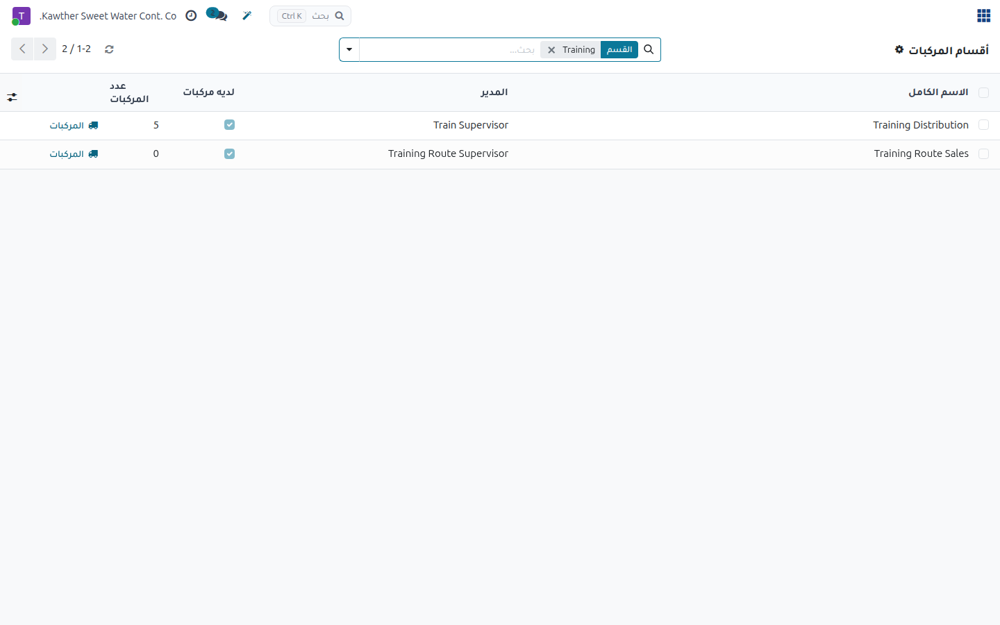
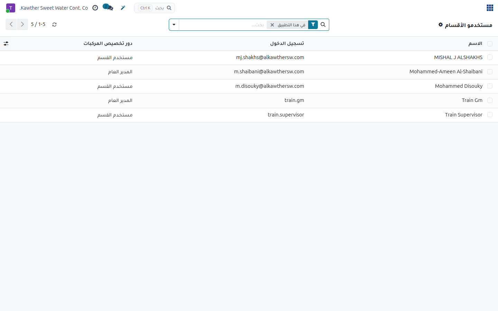
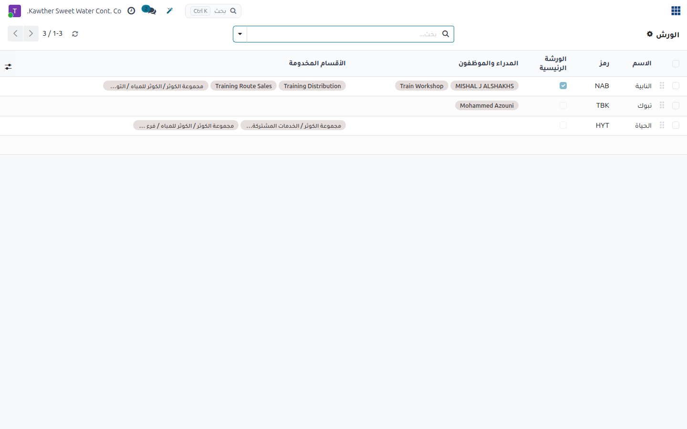

# تهيئة المركبات والعهد ونقل الموظفين والوثائق

**الفئة المستهدفة:** مسؤول النظام
**الوقت المقدّر:** جلسة واحدة عند التشغيل، ثم كلما تغيّر الأشخاص

## ما الذي تفعله هذه الشاشة

تحتاج التطبيقات أربعة أنواع من التهيئة: **من يعمل لأي قسم**، و**أي الأقسام لديها مركبات وأي ورشة
تخدمها**، و**من يعمل في أي ورشة**، و**ما الذي يُفحص عند التسليم**. نفّذها بهذا الترتيب عند التشغيل.

## ١. الأقسام التي لديها مركبات

**تخصيص المركبات ← الإعدادات ← أقسام المركبات.** ضع علامة **لديه مركبات** للأقسام المسؤولة عن
مركبات؛ ويعرض **عدد المركبات** ما لدى كل قسم. ويجب أن يكون لكل مركبة من مركبات الشركة قسم:
**تخصيص المركبات ← المركبات**، مع فلتر *بلا قسم*.

## ٢. من يعمل لأي قسم

**تخصيص المركبات ← الإعدادات ← مستخدمو الأقسام.** امنح كل مشرف صلاحية **مستخدم القسم** وقسمه
(أو أقسامه). والمدير العام يأخذ صلاحية **المدير العام** التي ترى كل الأقسام وتبتّ فيها.

وفي **نقل الموظفين** يعمل **مقدم الطلب** للأقسام التي **يديرها** (*مدير* القسم): حافظ على صحة
المدراء في الموظفين ← الأقسام.

## ٣. الورش: موظفوها والأقسام التي تخدمها

**الورشة ← الإعدادات ← الورش.** لكل ورشة أضف **المدراء والموظفون**، وفي **الأقسام المخدومة**
الأقسام التي تستقبل طلباتها (القسم الفرعي يتبع أصله، والقسم الذي لا تخدمه أي ورشة يذهب إلى
النابية، الورشة الرئيسية). ومن ليس في أي ورشة لا يرى أي طلبات.

## ٤. ما الذي يُفحص عند التسليم

**المستندات ← الإعدادات ← أنواع المستندات**، عمود **تُفحص عند تسليم المركبة**. أي مستند مطلوب
للمركبة أو للسائق الجديد يكون ناقصًا أو منتهيًا يوقف التسليم. فعّل النوع فقط عندما يحتويه السجل
للجميع (استورد أولًا)، وإلا توقفت كل عمليات التسليم.

## الصلاحيات باختصار

| الصلاحية (الإعدادات ← المستخدمون) | تُمنح لـ |
|---|---|
| تخصيص المركبات: **مستخدم القسم** (+ الأقسام) | مشرف كل قسم لديه مركبات |
| تخصيص المركبات: **المدير العام** | المدير العام |
| نقل الموظفين: **مقدم طلب** | مدراء الأقسام |
| نقل الموظفين: **الموارد البشرية** / **المدير العام** | الموارد البشرية / المدير العام |
| عهدة المركبات: **الموارد البشرية / الشؤون الإدارية** (تشمل مسؤول المستندات) | الموارد البشرية / الشؤون الإدارية |
| عهدة المركبات: **الحسابات (نسخة للعلم)** | المحاسب الذي يتابع إهلاك المركبات |
| الورشة: **مدير** / **الفني** (+ الورش) | موظفو الورش |
| الأسطول: **ربط التيدرات بالرؤوس** / **تعديل بيانات التيدرات** | المنسق / الموارد البشرية |

