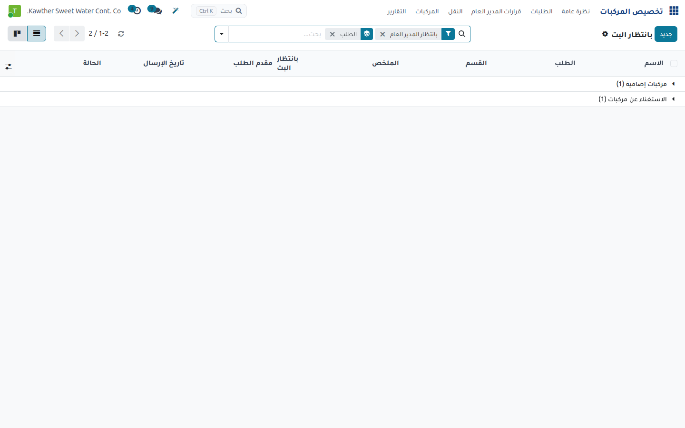
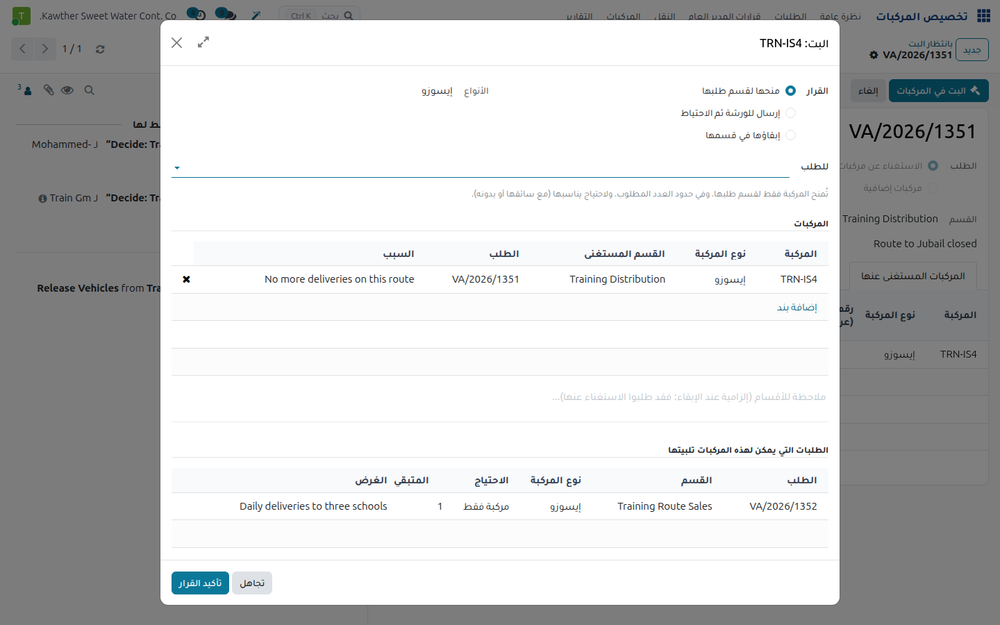
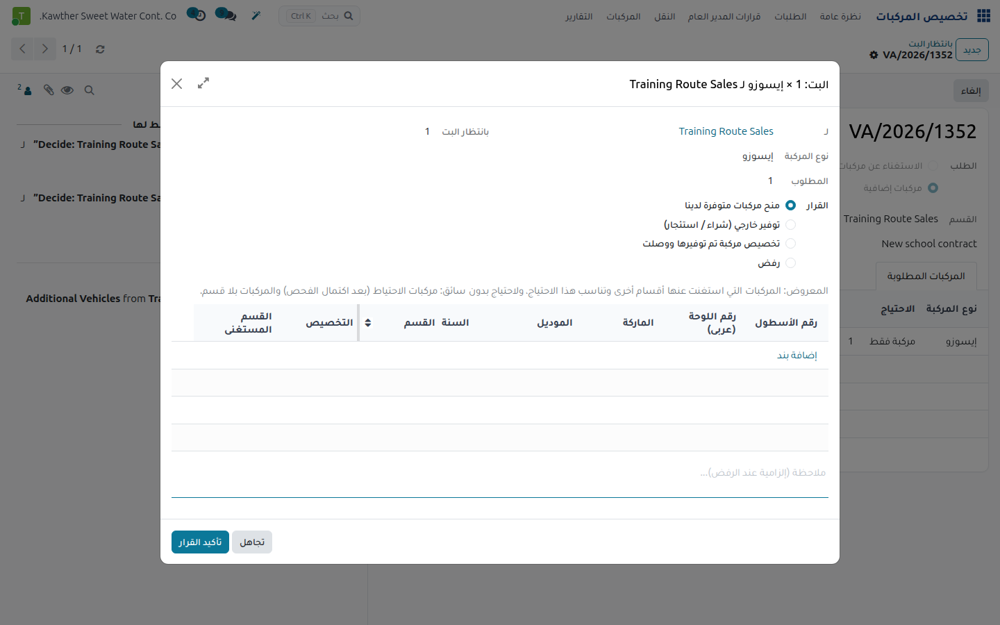

# البت في طلبات المركبات

**الفئة المستهدفة:** المدير العام (تخصيص المركبات، *المدير العام*)
**الوقت المقدّر:** دقيقة لكل مركبة

## ما الذي تفعله هذه الشاشة

الأقسام **تستغني** عن مركبات و**تطلب** مركبات، وأنت وحدك من يقرر. تبتّ في كل مركبة
من الطلب نفسه. وكل ما بعد قرارك (الورشة، مراجعة الموارد البشرية، نموذج التسليم) تنفيذ
لا يحتاج منك شيئًا آخر.

## قبل أن تبدأ

- كل طلب بانتظارك يظهر في **صفحتك الرئيسية** وفي **تخصيص المركبات ← قرارات المدير العام
  ← طلبات بانتظار البت**.
  

## البت في استغناء

1. **افتح الطلب** واضغط **البت في المركبات**.

2. **اختر القرار** للمركبات المعروضة:

   | القرار | النتيجة |
   |---|---|
   | **منحها لقسم طلبها** | اختر **للطلب**: لا تظهر إلا الطلبات المفتوحة من النوع نفسه، التي فيها متسع، واحتياجها يناسب (مع السائق أو بدونه). تذهب المركبة إلى الورشة للفحص ثم إلى ذلك القسم |
   | **إرسال للورشة ثم الاحتياط** | تذهب المركبة إلى الورشة وتنتظر في **مركبات الاحتياط** لطلب قادم |
   | **إبقاؤها في قسمها** | يحتفظ بها القسم. اكتب السبب في الملاحظة (فقد طلب الاستغناء عنها) |

   الجدول السفلي يعرض الطلبات المفتوحة التي يمكن لهذه المركبات تلبيتها.
   

3. **اضغط تأكيد القرار.**

## البت في طلب مركبات

1. **افتح الطلب** واضغط **البت** على السطر.
2. **اختر القرار**:

   | القرار | النتيجة |
   |---|---|
   | **منح مركبات متوفرة لدينا** | اختر من المركبات التي استغنت عنها أقسام أخرى وتناسب الطلب، أو من الاحتياط (بعد اكتمال الفحص) |
   | **توفير خارجي (شراء / استئجار)** | العدد المطلوب شراؤه أو استئجاره، ويبقى السطر بانتظارها |
   | **تخصيص مركبة تم توفيرها ووصلت** | يمنح مركبة اشتُريت أو استؤجرت ووصلت |
   | **رفض** | اكتب السبب |

   

3. **اضغط تأكيد القرار.**

## الاطلاع على المستندات

**عهدة المركبات ← المستندات** تعرض للاطلاع فقط مستندات جميع المركبات والموظفين مع تواريخ
انتهائها، وكذلك تبويب **المستندات** في ملف الموظف. وتعديلها يبقى لدى الموارد البشرية.

## ماذا يحدث بعد ذلك

تُبلَّغ الأقسام. المركبة التي تمنحها تمر على الورشة ونماذج التسليم والاستلام (HR-12)،
ويحدد القسم المستلم سائقها. والمركبة المستغنى عنها **مع السائق** تنتقل معه فورًا.

## مشكلات شائعة

| المشكلة | السبب | الحل |
|---|---|---|
| **للطلب** لا يعرض شيئًا | لا يوجد طلب مفتوح مناسب (النوع، الاحتياج، الكمية، ليس القسم نفسه) | أرسلها إلى الاحتياط، أو انتظر طلبًا |
| لا يظهر زر البت في استغناء | لم يُرسل بعد أو تم البت فيه | راجع حالته |

