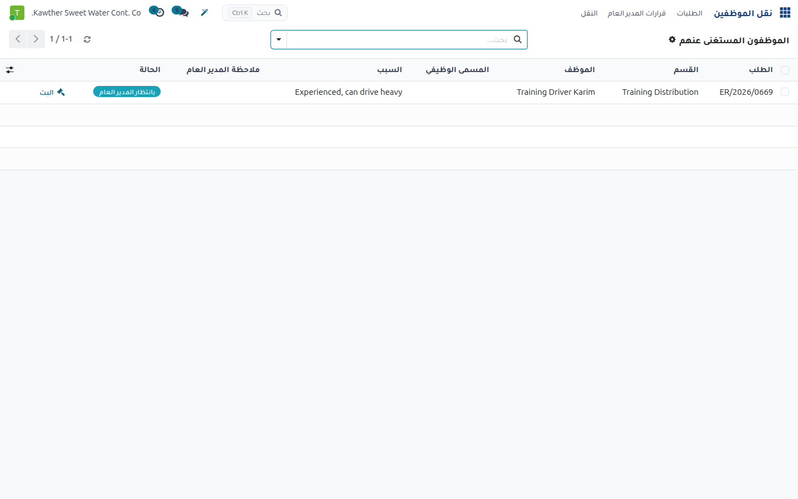
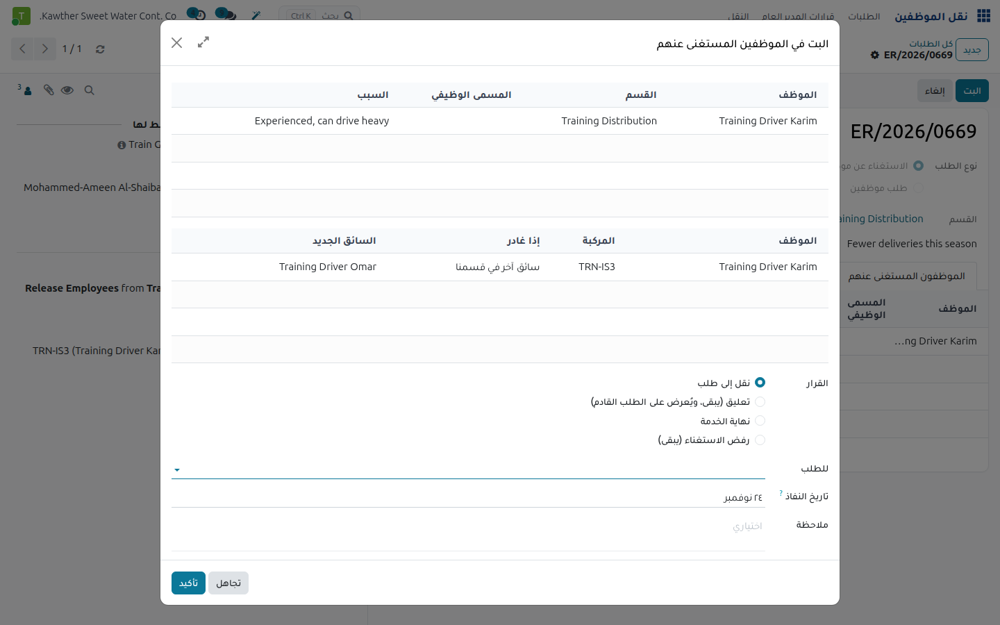
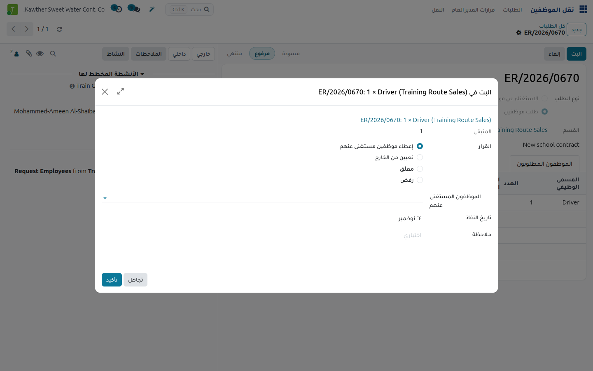

# البت في الاستغناء عن الموظفين وطلبهم

**الفئة المستهدفة:** المدير العام (نقل الموظفين، *المدير العام*)
**الوقت المقدّر:** دقيقة لكل موظف

## ما الذي تفعله هذه الشاشة

الأقسام **تستغني** عن موظفين و**تطلب** موظفين، وأنت تقرر. وترى مع الموظف المستغنى عنه
ما قرره قسمه بشأن **المركبات في عهدته**، لأن قرارك ينفّذ تلك الخطة.

## البت في استغناء

1. **افتح الطلب** من صفحتك الرئيسية أو من **نقل الموظفين ← قرارات المدير العام ←
   الموظفون المستغنى عنهم**، واضغط **البت**.
   

2. **راجع الجدولين**: الموظفون، و**مركباتهم في حال مغادرتهم** (تغيير السائق إلى من، أو
   الاستغناء إلى الورشة).

3. **اختر القرار**:

   | القرار | النتيجة |
   |---|---|
   | **نقل إلى طلب** | اختر **للطلب** (قسم طلب وظيفته) و**تاريخ النفاذ**. تكمل الموارد البشرية النقل |
   | **تعليق** | يبقى في قسمه ويُعرض على الطلب القادم |
   | **نهاية الخدمة** | **تاريخ النفاذ** هو تاريخ انتهاء خدمته؛ وتكمله الموارد البشرية |
   | **رفض الاستغناء** | يبقى، ولا يحدث شيء لمركباته |

   

4. **اضغط تأكيد.** في النقل أو نهاية الخدمة تُنفَّذ خطة المركبات الآن: يكتمل تغيير السائق،
   ويذهب الاستغناء إلى الورشة إلى تخصيص المركبات. وإذا لم يعد شيء في الخطة صالحًا (رخصة
   انتهت، أو سائق أُخذ في الأثناء) يتوقف القرار مع السبب: أعده إلى القسم.

## البت في طلب موظفين

1. **افتح الطلب** واضغط **البت** على السطر.
2. **إعطاء موظفين مستغنى عنهم** (اخترهم)، أو **تعيين من الخارج**، أو **معلّق**، أو **رفض**، مع العدد.
   
3. **اضغط تأكيد.**

## ماذا يحدث بعد ذلك

تحدد الموارد البشرية لكل موظف منقول مديره الجديد والمعتمدين، وتنفّذ النقل في تاريخه، وتسمّي
المعيَّنين الجدد. وتُبلَّغ الأقسام.

