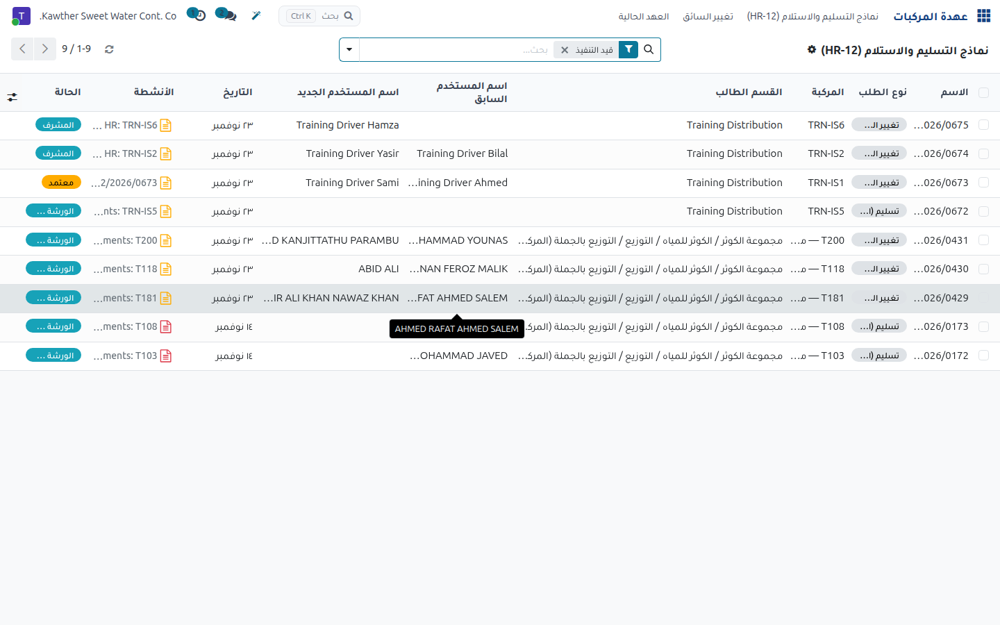
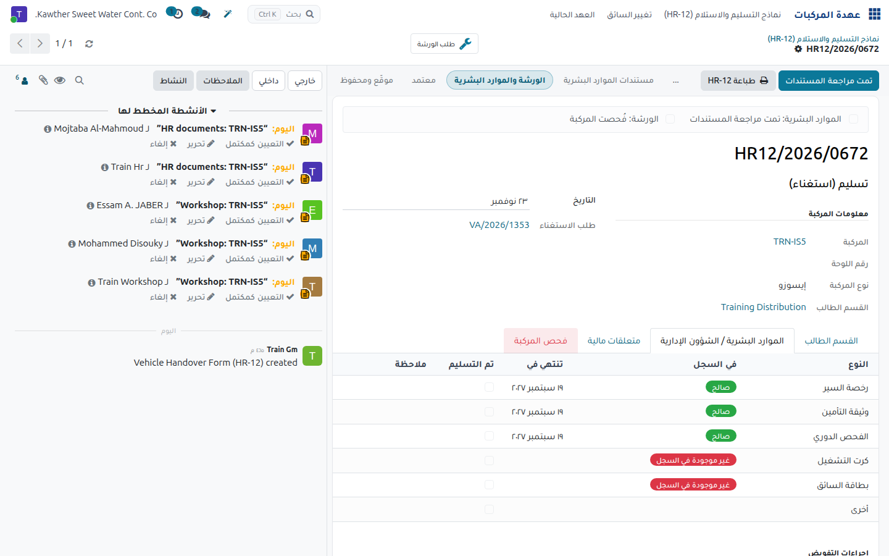
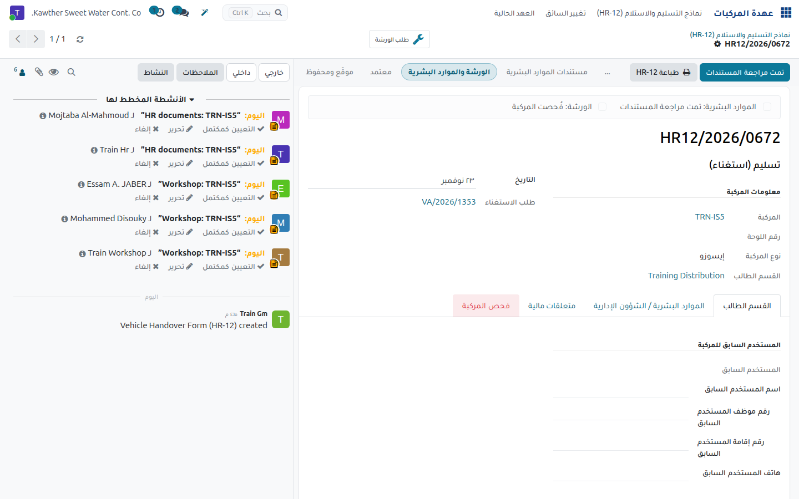

# HR-12: مراجعة مستندات التسليم

**الفئة المستهدفة:** الموارد البشرية / الشؤون الإدارية (عهدة المركبات، *الموارد البشرية / الشؤون الإدارية*)
**الوقت المقدّر:** دقيقتان لكل نموذج

## ما الذي تفعله هذه الشاشة

يرافق نموذج التسليم والاستلام **HR-12** المركبة عند انتقال عهدتها. للموارد البشرية خطوة
في نوعين من النماذج؛ والمدير العام قد قرر مسبقًا، فأنت تكمل قسمك ولا تعتمد:

| النموذج | متى | دورك |
|---|---|---|
| **تسليم (استغناء)** | مركبة مستغنى عنها تذهب إلى الورشة | التأكد من تسليم مستنداتها، **بالتوازي** مع فحص الورشة |
| **استلام** | قسم يستلم مركبة ويحدد سائقها | مراجعة السائق الجديد والمستندات **قبل** أن تسلّمها الورشة |

أما **تغيير السائق** داخل القسم فلم تعد فيه خطوة للموارد البشرية: يكتمل عند تأكيد المشرف،
وتصلك رسالة بما ينقص السجل إن وُجد، للعلم.

## الخطوات

1. **افتح النموذج** من صفحتك الرئيسية (*مستندات الموارد البشرية: …*) أو من **عهدة
   المركبات ← نماذج التسليم والاستلام (HR-12)**.
   

2. **افتح تبويب الموارد البشرية / الشؤون الإدارية.** يعرض كل سطر مستند ما يحتويه
   **السجل** (ساري / قارب على الانتهاء / منتهٍ / غير موجود في السجل) مع تاريخ الانتهاء،
   فلا تراجعه يدويًا. ضع علامة **تم التسليم** لما استلمته، وأضف الملاحظات.
   

3. في **الاستلام** تُقرأ **فئة رخصة** المستخدم الجديد و**تاريخ انتهائها** من السجل، وتُعاد
   شروط السائق (مركبة واحدة، قسمه، رخصة سارية من الفئة المناسبة).

4. **اضغط تمت مراجعة المستندات.** في التسليم ينتظر النموذج الورشة إن لم تنتهِ، وفي
   الاستلام ينتقل إلى الورشة التي يكون تسليمها هو وصول المركبة.
   

## ماذا يحدث بعد ذلك

عندما تنتهي الورشة أيضًا يصبح النموذج **معتمد**: تنتقل العهدة، وتُبلَّغ الحسابات والقسم.
ثم يطبع القسم الورقة ويوقّعها ويحفظها.

## مشكلات شائعة

| المشكلة | السبب | الحل |
|---|---|---|
| لا يظهر زر **تمت مراجعة المستندات** | النموذج ليس في خطوتك | راجع شريط الحالة |
| «لا تنتقل عهدة … حتى يحتوي سجل الوثائق على …» | ينقص السجل مستند للمركبة أو السائق | سجّله (انظر [سجل الوثائق](07-documents-register.md)) ثم اضغط مرة أخرى |

