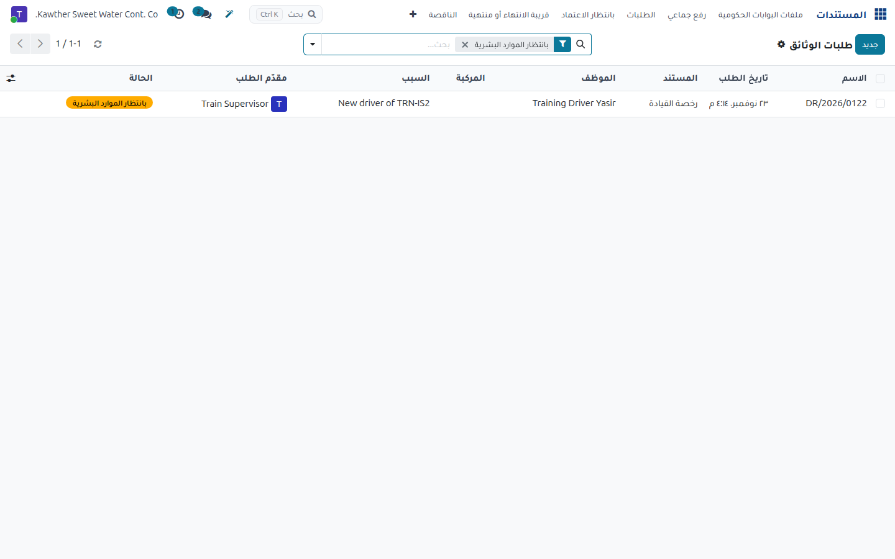
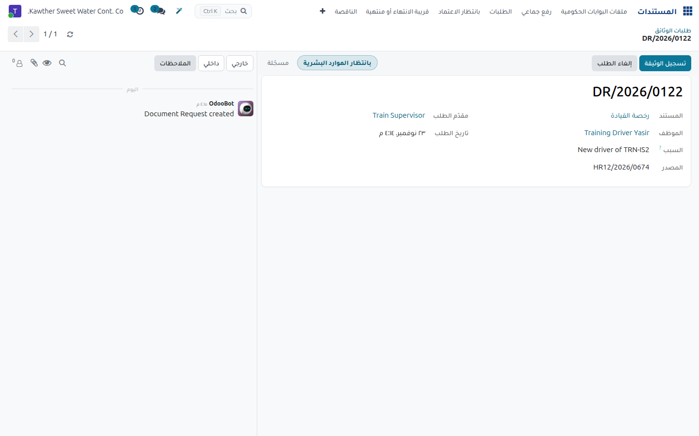
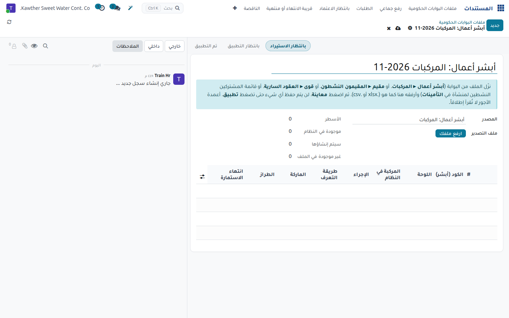
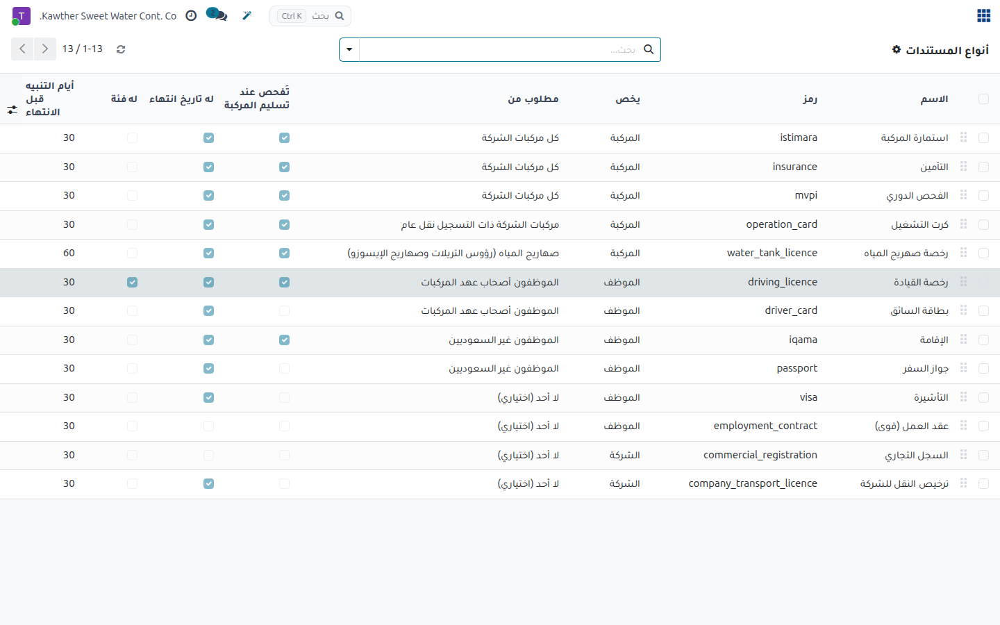

# سجل الوثائق وطلبات الوثائق

**الفئة المستهدفة:** الموارد البشرية / الشؤون الإدارية (المستندات، *مسؤول المستندات*)
**الوقت المقدّر:** بحسب العمل

## ما الذي تفعله هذه الشاشة

تطبيق **المستندات** هو السجل الوحيد لأوراق كل مركبة وكل موظف: الاستمارة، التأمين، الفحص
الدوري، بطاقة التشغيل، رخصة الصهريج، رخصة القيادة، بطاقة السائق، الإقامة، الجواز. ونماذج
التسليم تقرأ منه: **لا تنتقل عهدة مركبة ما دام مستند مفحوص ناقصًا أو منتهيًا.** المشرفون لا
يطّلعون على السجل؛ وعندما يحتاجون شيئًا منه يرسلون إليك **طلب وثيقة**.

## الرد على طلبات الوثائق

1. **افتح المستندات ← الطلبات** (وتظهر أيضًا في صفحتك الرئيسية باسم *طلبات الوثائق*).
   الأقدم أولًا؛ وكل طلب يذكر المطلوب، ولمن، وسببه (مثل *السائق الجديد للمركبة TRN-IS2*)،
   ومن طلبه.
   

2. **افتح الطلب واضغط تسجيل الوثيقة.** يُفتح نموذج الوثيقة مرتبطًا بالموظف أو المركبة.
   

3. **أدخل الرقم وتاريخ الانتهاء** (وأرفق الصورة إن توفرت) ثم **اعتمد**. يُغلق الطلب تلقائيًا
   وتصل المشرف رسالة.

> أي وثيقة سارية من النوع نفسه تُعتمد لذلك الموظف أو المركبة تُغلق الطلب، أيًا كانت طريقة
> إدخالها (رفع، رفع جماعي، ملف حكومي).

## استيراد ملفات البوابات الحكومية

أسرع طريقة لتعبئة السجل. **المستندات ← ملفات البوابات الحكومية ← جديد**، اختر **المصدر**،
وأرفق الملف، ثم **معاينة**، وراجع التنبيهات، ثم **تطبيق**. لا يُكتب شيء قبل التطبيق، ولا تحل
وثيقة أقدم محل وثيقة في النظام.

| المصدر | من | يعبّئ |
|---|---|---|
| **أبشر أعمال: المركبات** | أبشر ← المركبات | الاستمارة، الفحص، حالة التأمين، المستخدم الفعلي |
| **أبشر أعمال: حاملو رخص القيادة** | أبشر ← حاملو الرخص (المقيمون) | رخصة القيادة: الرقم = رقم الإقامة، الفئة، الانتهاء |
| **مقيم: المقيمون النشطون** | مقيم ← المقيمون النشطون | الإقامة، الجواز |
| **قوى / التأمينات** | قوائم البوابتين | العقود، المنشأة |
| **تقرير فحص الصهاريج (فاحص)** | تقرير الفحص | رخصة الصهريج |

وتنبّه معاينة الرخص كذلك إلى صاحب عهدة تريلا برخصة من فئة غير مناسبة، وتعرض المقيمين الذين
لديهم مركبة وليست لهم رخصة في الملف.

## ما الذي يُفحص عند التسليم

**المستندات ← الإعدادات ← أنواع المستندات**: يحدد عمود **تُفحص عند تسليم المركبة** المستندات
التي توقف التسليم. بطاقة السائق متوقفة إلى أن تُسجَّل البطاقات للجميع؛ فعّلها حينئذ.

## سائق مسموح له بمركبتين

السائق الواحد عهدته مركبة واحدة مقودة. وللاستثناء المعتمد: افتح الموظف، تبويب **عهدة
المركبات**، واجعل **عدد المركبات المسموح بعهدتها** ٢، واكتب **سبب السماح بأكثر من مركبة**.

## مشكلات شائعة

| المشكلة | السبب | الحل |
|---|---|---|
| «هذا ملف رخص القيادة من أبشر…» | استُورد الملف بمصدر مقيم | اختر **أبشر أعمال: حاملو رخص القيادة** |
| سطر يقول *ليس موظفًا في النظام* | لا يوجد موظف بهذا الرقم | أضف الموظف (رقم الإقامة في رقم الضمان الاجتماعي) وأعد المعاينة |

