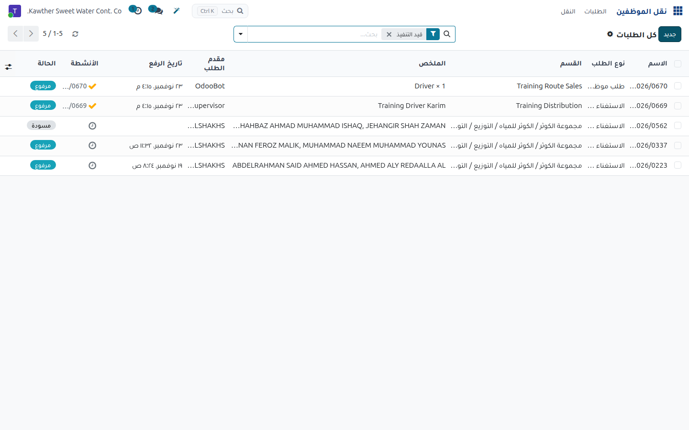

# نقل الموظفين: دور الموارد البشرية

**الفئة المستهدفة:** الموارد البشرية (نقل الموظفين، *الموارد البشرية*)
**الوقت المقدّر:** ٣ دقائق لكل نقل

## ما الذي تفعله هذه الشاشة

عندما ينقل المدير العام موظفًا مستغنى عنه، أو ينهي خدمته، تتولى الموارد البشرية التنفيذ.
أنت لا تقرر؛ بل تكمل ما يحتاجه النقل.

## إكمال النقل

1. **افتحه** من صفحتك الرئيسية أو من **نقل الموظفين ← النقل**. حالته **لدى الموارد البشرية**.
2. **راجع المدير الجديد ومعتمد الإجازات ومعتمد الحضور ومسؤول الموارد البشرية المقترحين**:
   مأخوذون من القسم الجديد. صحّحهم إن لزم (جميعها مطلوبة).
3. **اضغط تأكيد.** ينتظر **تاريخ النفاذ** (**معتمد، بانتظار تاريخ النفاذ**) ويصبح **منفّذ** في
   ذلك اليوم: يتغير قسمه ومديره ومعتمدوه.

> **المركبات أولًا.** إذا كان لا يزال صاحب عهدة مركبة فإن النقل ينتظر حتى تُسلَّم (تغيير السائق
> أو التسليم في خطة الاستغناء)، ثم يُنفَّذ فورًا.

وإذا تعذّر النقل اضغط **إعادة إلى المدير العام** مع السبب.

## نهاية الخدمة والتعيين

- **نهاية الخدمة** بقرار المدير العام: افتح طلب الاستغناء واضغط **نهاية الخدمة** لبدء طلب نهاية
  خدمته بتاريخ الانتهاء.
- **التعيين من الخارج**: بعد إنشاء الموظفين الجدد افتح الطلب واضغط **تسمية المعيَّنين الجدد**.

