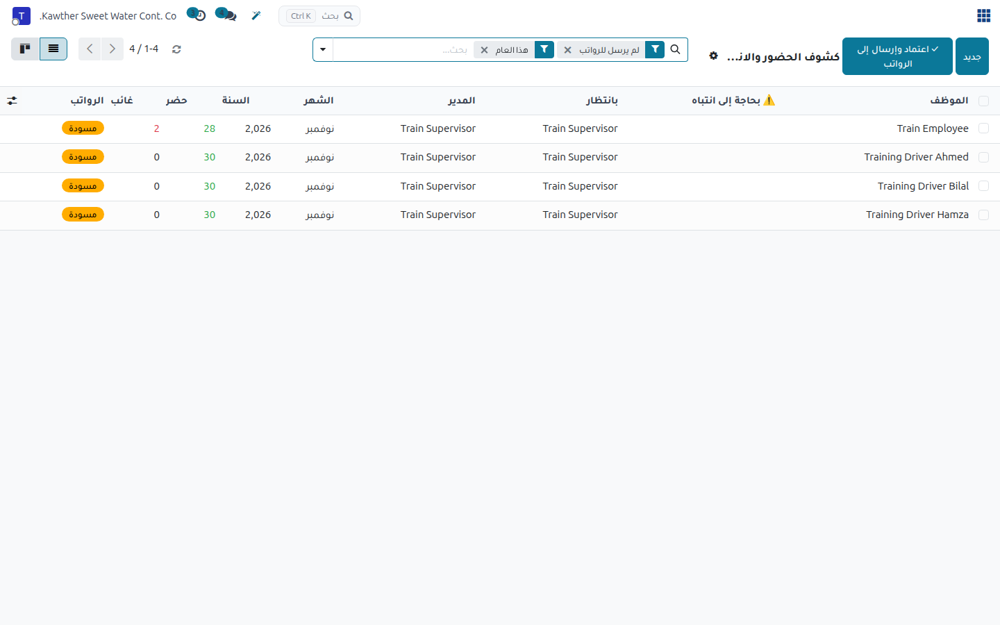
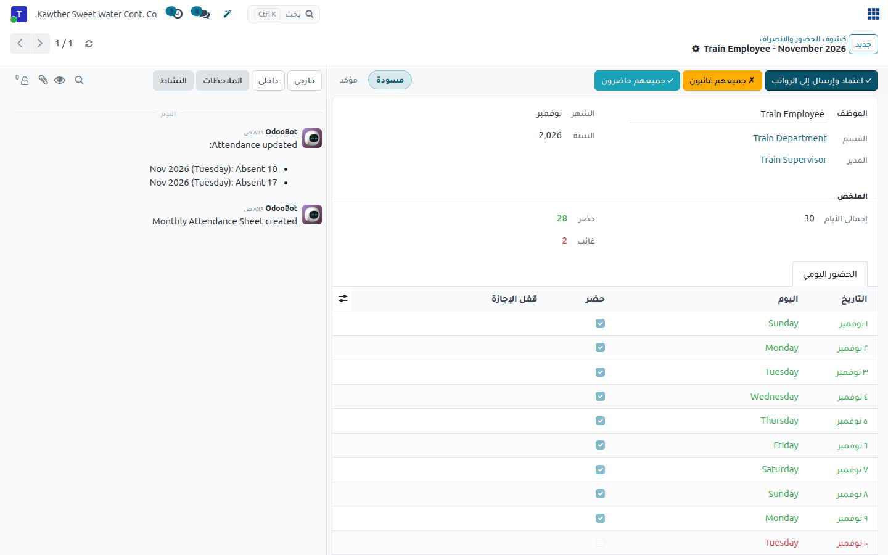
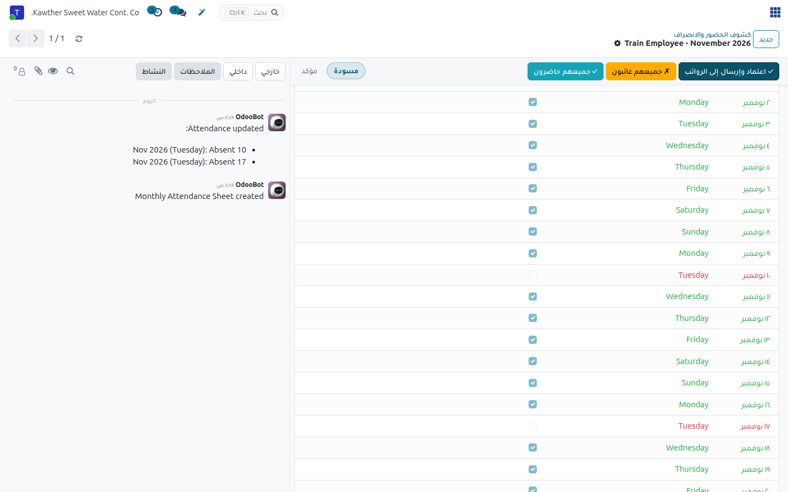
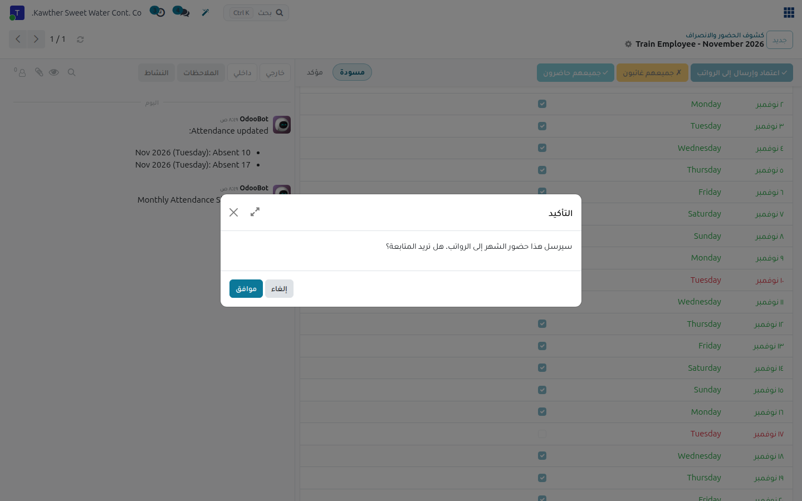
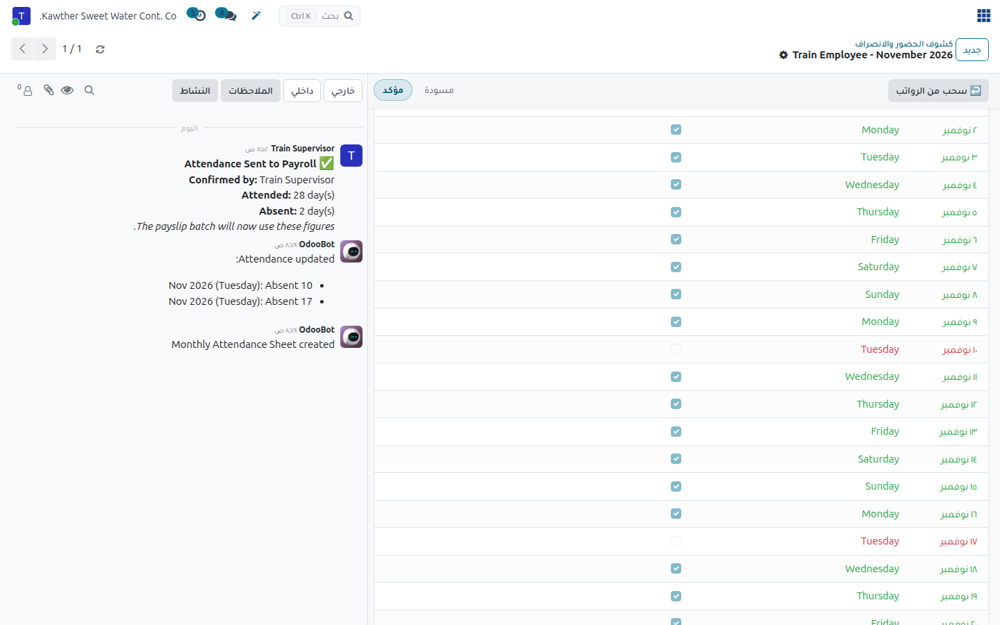
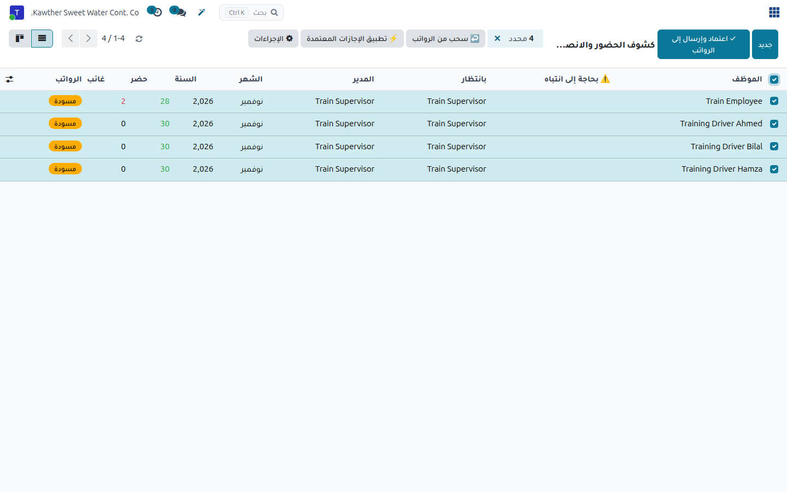

# تسجيل الحضور الشهري وإرساله إلى الرواتب

**الفئة المستهدفة:** المشرف / المدير المباشر
**ينطبق على:** موظفيك الذين **لا يستخدمون جهاز البصمة** (كشف الحضور)
**الوقت المقدّر:** ٥ دقائق شهريًا

## نظرة عامة

الموظف الذي لا يبصم ليس له سجل حضور إلا ما **تُقرّه أنت** في كشفه الشهري. يُنشئ
النظام الكشف تلقائيًا في بداية كل شهر، وعليك أمران فقط:

1. **سجّل الغياب** — أزل علامة «حضر» عن أيام الغياب.
2. **اضغط ✓ اعتماد وإرسال إلى الرواتب** قبل انتهاء الشهر.

> **مهم:** الكشف الذي لا تعتمده **لا يصل إلى الرواتب**، ويُصرف الراتب للموظف بوصفه
> **صفر أيام حضور**. ولا يعتمد أحدٌ الكشف نيابةً عنك.

## قواعد يجب معرفتها

- ترى كشوف **موظفيك المباشرين فقط**.
- تستطيع التعديل والاعتماد في **الشهر الجاري فقط**. بعد انتهاء الشهر يصبح الكشف
  **«مراجعة فقط»** ولا يتصرف فيه إلا **مسؤول كشوف الحضور** في الموارد البشرية.
- أيام **الإجازة المعتمدة** وأيام الراحة حسب جدول الموظف يضبطها النظام، فلا تُعدِّلها.
- لا يقبل النظام اعتماد كشف يُظهر الموظف **حاضرًا** في يوم يقع داخل إجازة معتمدة.

## الخطوات

### ١. افتح كشوف الحضور

من تطبيق **الحضور** اختر **كشوف الحضور والانصراف**. تفتح القائمة على كشوف السنة
الحالية **التي لم تُرسل للرواتب** بعد — أي ما ينتظرك أنت.

أعمدة تهمّك في القائمة:

| العمود | معناه |
|---|---|
| **حضر / غائب** | عدد أيام الحضور والغياب المسجَّلة في الكشف |
| **⚠ بحاجة إلى انتباه** | سبب يمنع الاعتماد — الصف يظهر **بالأحمر** |
| **بانتظار** | الشخص الذي عليه الإجراء التالي |
| **الرواتب** | **مسودة** = لم يُرسل بعد · **مؤكد** = أُرسل للرواتب |

### ٢. افتح كشف الموظف وسجّل الغياب

اضغط على اسم الموظف. يظهر في تبويب **الحضور اليومي** سطر لكل يوم من الشهر.

- **يوم غياب:** أزل علامة ✓ من عمود **حضر** — يتحوّل السطر إلى **الأحمر**.
- **الشهر كله غياب أو حضور:** استخدم **✗ جميعهم غائبون** أو **✓ جميعهم حاضرون**،
  ثم صحّح الأيام المستثناة يدويًا.
- يُحفظ التعديل تلقائيًا، ويُسجَّل كل تغيير في سجل الملاحظات على يسار الشاشة.

راجع **الملخص** (حضر / غائب) في أعلى الكشف قبل الانتقال للخطوة التالية.

### ٣. اعتمد الكشف وأرسله إلى الرواتب

اضغط **✓ اعتماد وإرسال إلى الرواتب** في أعلى الكشف، ثم **موافق** في رسالة التأكيد.

تتحوّل الحالة إلى **مؤكد**، ويُسجَّل في الملاحظات اسمك وعدد أيام الحضور والغياب
التي ستعتمد عليها الرواتب.

### اعتماد الفريق كله دفعة واحدة

إن كانت كشوف فريقك جاهزة، اعتمدها معًا من القائمة:

- اضغط **✓ اعتماد وإرسال إلى الرواتب** في أعلى القائمة **دون تحديد أي صف**
  لاعتماد جميع كشوفك المعلّقة للشهر الجاري، **أو**
- حدّد الصفوف المطلوبة بمربعات الاختيار ثم اضغط الزر نفسه.

يعتمد النظام الكشوف السليمة، ويعرض لك قائمة بالكشوف التي تعذّر اعتمادها مع السبب
لكل منها — صحّحها ثم اعتمدها من جديد.

## إذا ظهر «⚠ لا يمكن إرسال هذا الشهر إلى الرواتب بعد»

يظهر هذا التنبيه الأحمر داخل الكشف حين يتعارض مع سجل الإجازات:

| السبب الظاهر | ما تفعله |
|---|---|
| أيام مسجَّلة **حاضر** داخل إجازة معتمدة | اضغط **تطبيق الإجازات المعتمدة** داخل التنبيه — يُعلِّم النظام تلك الأيام غيابًا مطابقةً للإجازة، ثم اعتمد الكشف |
| مباشرة الموظف بعد إجازته **لم تُؤكَّد** | يجب أولًا تأكيد تاريخ عودته من **الإجازات ← تأكيد المباشرة** (الشخص المذكور في «بانتظار»)، ثم اعتمد الكشف |
| أيام قبل تاريخ التحاق الموظف | راجع الموارد البشرية لتصحيح تاريخ بداية العقد |

## تصحيح كشف بعد اعتماده

ما دام الشهر **جاريًا**، تستطيع التراجع بنفسك:

1. افتح الكشف واضغط **↩ سحب من الرواتب** (أو حدّد عدة كشوف في القائمة واضغط
   الزر نفسه).
2. يعود الكشف إلى **مسودة** — صحّح الأيام.
3. **اعتمده من جديد.** إلى أن تفعل، تقرأه الرواتب **صفر أيام حضور**.

بعد انتهاء الشهر لا يمكنك السحب؛ اطلب التصحيح من **مسؤول كشوف الحضور** في الموارد
البشرية.

> **إجازة اعتُمدت بعد اعتمادك:** إن اعتُمدت للموظف لاحقًا إجازة تشمل أيامًا في كشف
> معتمد، **يُسحب اعتمادك تلقائيًا** ويعود الكشف مسودة — راجعه واعتمده مرة أخرى.

## مشكلات شائعة

| العَرَض | السبب | الحل |
|---|---|---|
| لا يظهر كشف لأحد موظفيك | الموظف غير مُفعَّل عليه «يستخدم كشف الحضور»، أو تنقصه بيانات (المدير، الجدول، هيكل الراتب) | راجع الموارد البشرية |
| الكشف عليه شريط **«مراجعة فقط»** | الشهر انتهى أو الكشف معتمد | للتصحيح: اسحبه من الرواتب (الشهر الجاري) أو راجع الموارد البشرية |
| يوم لا يقبل التعديل | يوم إجازة معتمدة أو يوم راحة | هذا متوقَّع |
| زر الاعتماد غير ظاهر | الكشف معتمد أصلًا، أو ليس من موظفيك، أو الشهر انتهى | تحقّق من عمود **الرواتب** و**المدير** |
| صُرف للموظف صفر أيام | الكشف لم يُعتمد في شهره | راجع الموارد البشرية — لا يعتمد الشهر المنتهي سواهم |

## الخلاصة

**كل شهر، قبل نهايته:** افتح الكشوف ← سجّل الغياب ← **✓ اعتماد وإرسال إلى الرواتب**.

## أدلة ذات صلة

- [اعتماد الإجازات](01-approve-time-off.md)
- [تسجيل المستحقات الإضافية](04-commission-pay-entries.md)

