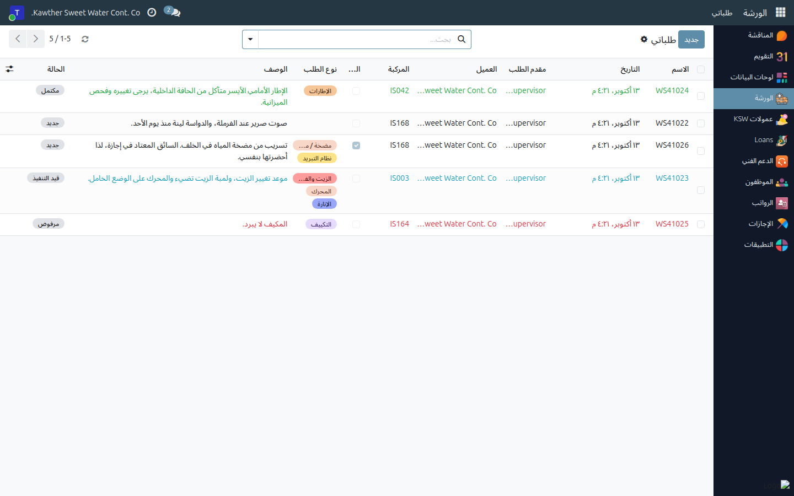
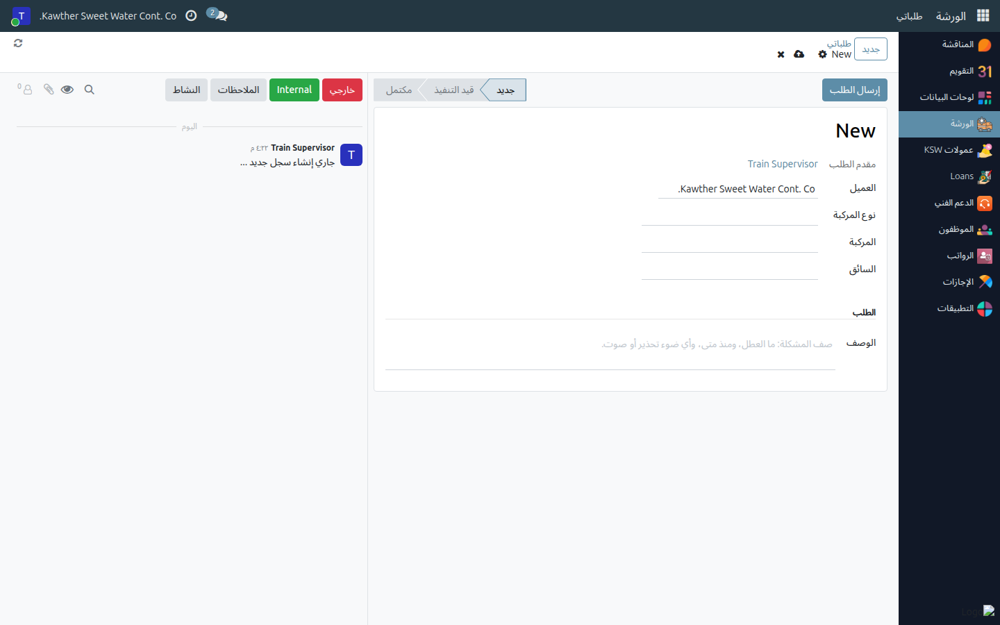
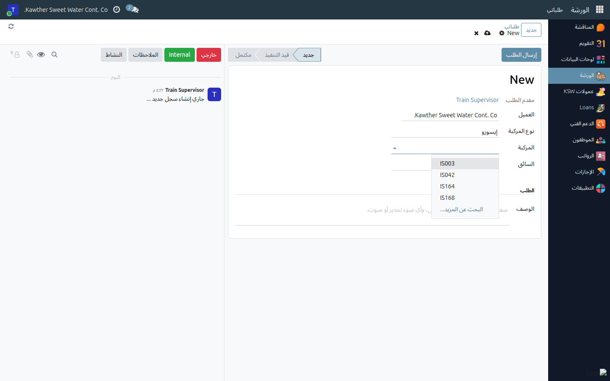
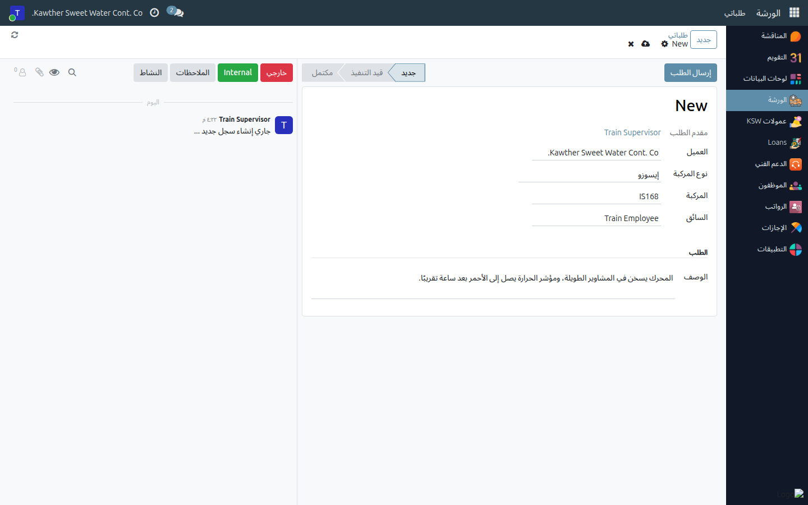
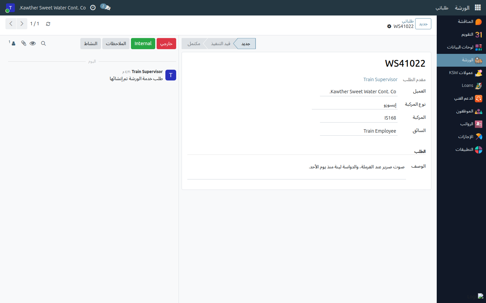
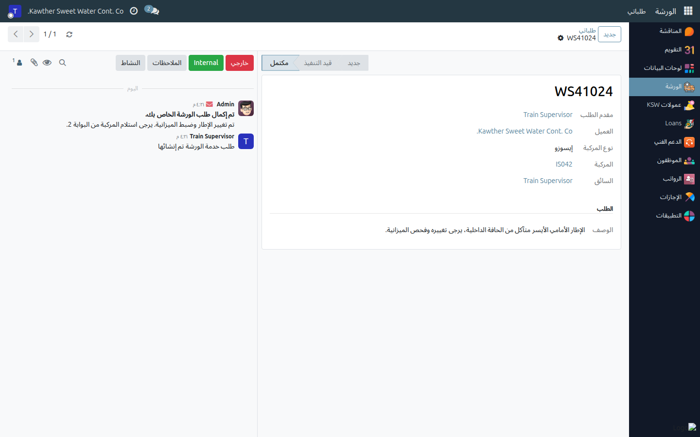
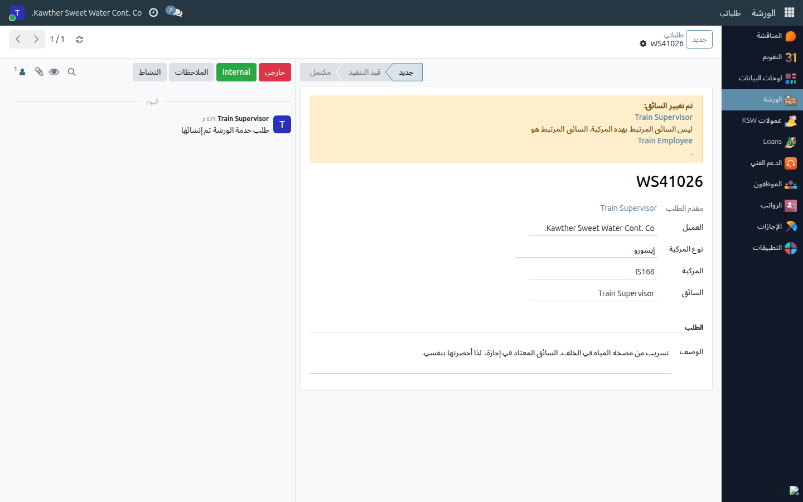

# تقديم طلب خدمة الورشة

**الفئة المستهدفة:** مقدمو طلبات الورشة: مشرفو الإيسوزو والتريلات، ومدير قسم الصيانة
**الوقت المقدّر:** دقيقتان

---

## ما الذي تفعله هذه الشاشة

تطلب من الورشة فحص إحدى مركباتك أو إصلاحها، بطلب مسجّل يمكن متابعته بدلًا
من الاتصال الهاتفي أو نموذج Google القديم. يُشعَر مدير الورشة لحظة إرسالك
الطلب، وتتابع الطلب من الشاشة نفسها حتى تنتهي المركبة.

يحصل كل طلب على رقم (`WS00001`، `WS00002`، …) ويمرّ بأربع حالات:

| الحالة | معناها |
|---|---|
| **جديد** | أرسلت الطلب ولم تبدأ الورشة العمل بعد. ما زال بإمكانك تصحيحه. |
| **قيد التنفيذ** | قبلت الورشة الطلب وتعمل على المركبة. |
| **مكتمل** | انتهى العمل. تصلك رسالة، وغالبًا فيها تفاصيل استلام المركبة. |
| **مرفوض** | لن تنفّذ الورشة هذا الطلب. تصلك رسالة توضّح السبب. |

---

## قبل أن تبدأ

- **تحتاج إلى صلاحية «مقدم طلب» في الورشة.** لا يقدّم الطلبات إلا
  المسؤولون عن المركبات. إذا فتحت **الورشة ← طلباتي** ولم تجد زر
  **جديد**، فليست لديك هذه الصلاحية؛ اطلبها من مدير النظام. (يُبلغ السائقون
  وبقية الموظفين مشرفهم بالعطل، والمشرف هو من يقدّم الطلب.)
- **لا يمكنك اختيار إلا مركباتك.** تعرض قائمة المركبات:
  - الشاحنات الموجودة في **مجموعات الصهاريج التابعة لك**، و
  - الشاحنات التي **يقودها أحد من فريقك**: أي شخص في تسلسلك الإداري، وأنت
    منهم.

  مجموعات الصهاريج هي نفسها التي تستخدمها في **Water Delivery ← Tankers**
  (توصيل المياه ← الصهاريج). إذا لم تظهر شاحنة أنت مسؤول عنها، فيجب أولًا
  إضافتها إلى مجموعة الصهاريج الخاصة بك.
- اعرف **رقم الأسطول** للمركبة (مثل `IS042` أو `T171`)، وجهّز وصفًا للمشكلة:
  ما العطل، ومنذ متى، وأي ضوء تحذير أو صوت.

---

## الخطوات

١. **افتح تطبيق الورشة ← طلباتي.** تعرض هذه القائمة كل طلب قدّمته وحالته
   الحالية.

   

٢. **اضغط جديد.** يُفتح طلب فارغ. حقل **مقدم الطلب** هو أنت ولا يمكن
   تغييره، وحقل **العميل** معبّأ مسبقًا باسم الشركة، وهو الصحيح لأي مركبة
   من مركبات الشركة.

   

٣. **اختر نوع المركبة:** **تريلا** أو **إيسوزو** أو **صهريج** أو **أخرى**.
   اختره أولًا، لأن قائمة **المركبة** لا تعرض إلا مركبات النوع الذي تختاره.

٤. **اختر المركبة.** اضغط على الحقل أو ابدأ بكتابة رقم الأسطول. لا تظهر إلا
   شاحناتك من هذا النوع: الموجودة في مجموعات الصهاريج التابعة لك، والتي
   يقودها فريقك.

   

٥. **تحقّق من السائق.** عند اختيار الشاحنة يُعبّأ حقل **السائق** تلقائيًا
   بالسائق المرتبط بها، وهو عادةً من يظهر في BAS أكثر من قادها خلال آخر
   أسبوعين، أو سائقها الافتراضي. إذا كان شخص آخر هو من يُحضر الشاحنة،
   فغيّره. هذا مسموح، لكن الطلب سيُظهر ذلك (انظر *ما الذي يحدث بعد ذلك*).
   حقل السائق إلزامي.

٦. **اكتب الوصف.** هذا أهم حقل في الطلب. تقرؤه الورشة لتخطيط العمل،
   ويستخدمه النظام لتصنيف الطلب حسب نوع الإصلاح (إطارات، فرامل، كهرباء…)،
   فلا تحتاج إلى اختيار النوع بنفسك. اكتب بوضوح، مثلًا: *«المحرك يسخن في
   المشاوير الطويلة، ومؤشر الحرارة يصل إلى الأحمر بعد ساعة تقريبًا»*، لا
   *«مشكلة في المحرك»* فقط.

   

٧. **اضغط إرسال الطلب** (أعلى النموذج). يُحفظ الطلب ويحصل على رقمه `WS…`
   ويُرسل إلى الورشة، وتؤكّد ذلك رسالة خضراء *«تم إرسال الطلب»*. (الحفظ
   بأيقونة السحابة يؤدي الغرض نفسه تمامًا.)

   

---

## ما الذي يحدث بعد ذلك

- **يراجع مدير الورشة الطلب.** عند قبوله تنتقل الحالة إلى **قيد التنفيذ**
  ويبدأ أحد الفنيين العمل على المركبة. تابع شريط الحالة أعلى الطلب.
- **عند انتهاء العمل** ينتقل الطلب إلى **مكتمل**، وتصلك رسالة في صندوق
  الوارد (أيقونة المحادثة أعلى يسار الشاشة) وعلى الطلب نفسه. وغالبًا تتضمّن
  ملاحظة من الورشة، مثل مكان استلام المركبة.

  

- **إذا لم تنفّذ الورشة الطلب** ينتقل إلى **مرفوض**، وتوضّح لك الرسالة
  السبب. من الأسباب الشائعة أن للمركبة نفسها طلبًا مفتوحًا بالفعل.

  

- **إذا غيّرت السائق** يظهر مربع أصفر بعنوان **تم تغيير السائق** أعلى الطلب
  لكل من يفتحه، يذكر السائق الذي أدخلته والسائق المرتبط بالشاحنة، لتعرف
  الورشة من أحضرها فعلًا. هذا طبيعي إذا كان السائق المعتاد في إجازة؛ اذكر
  السبب في الوصف.

  

- **للتواصل مع الورشة بشأن طلب** استخدم صندوق الرسائل على يسار الطلب: اضغط
  **خارجي** ثم اكتب رسالتك وأرسلها. أرفق صورة العطل أو ضوء التحذير بالطريقة
  نفسها. هكذا يبقى كل شيء على الطلب بدلًا من المكالمات.

> **ما يمكنك تغييره وما لا يمكنك.** ما دام الطلب **جديدًا** يمكنك تصحيح أي
> شيء عدا **مقدم الطلب**: افتحه وعدّله واحفظه. بعد أن تبدأ الورشة العمل
> يُقفل الطلب أمامك؛ ولإضافة أي معلومة اكتبها في صندوق الرسائل. أما تقرير
> الإصلاح (وقت الدخول والخروج، قراءة العداد، القطع، أجور العمل) فتعبّئه
> الورشة.

---

## مشكلات شائعة

| المشكلة | السبب | الحل |
|---|---|---|
| لا يوجد زر **جديد** في طلباتي | ليست لديك صلاحية «مقدم طلب» في الورشة | اطلبها من مدير النظام، وإلى ذلك الحين اطلب من مشرف لديه الصلاحية |
| قائمة **المركبة** فارغة | لم تختر **نوع المركبة**، أو ليست لديك شاحنات من هذا النوع | اختر النوع الصحيح أولًا، فالقائمة تتبعه |
| شاحنة أنا مسؤول عنها لا تظهر في القائمة | ليست في مجموعات الصهاريج التابعة لك، ولا يقودها أحد من فريقك | اطلب إضافتها إلى مجموعة الصهاريج الخاصة بك من شاشة Water Delivery ← Tankers |
| «المركبة … ليست من مركباتك: فهي ليست ضمن مجموعات الصهاريج التابعة لك ولا يقودها أحد من فريقك» | الشاحنة المختارة ليست من مركباتك | اختر إحدى شاحناتك، أو اطلب إضافتها إلى مجموعة الصهاريج الخاصة بك |
| حقل **السائق** عُبّئ بشخص غير صحيح | يظهر في BAS أن هذا الشخص هو من قاد الشاحنة مؤخرًا | غيّره إلى من يُحضر الشاحنة. سيُظهر الطلب «تم تغيير السائق»، وهذا متوقّع |
| «نوع المركبة والسائق مطلوبان…» عند الحفظ | حقل **السائق** فارغ (لا يوجد سائق مرتبط بالشاحنة) | اختر السائق بنفسك |
| لا أستطيع تعديل طلبي | لم يعد الطلب **جديدًا**: بدأته الورشة أو أنهته أو رفضته | اكتب في صندوق رسائل الطلب بدلًا من ذلك |
| لا يوجد خيار حذف | لا تُحذف الطلبات أبدًا ليبقى السجل كاملًا | إذا قدّمته بالخطأ، فاطلب من الورشة في صندوق الرسائل رفضه |

---

## أدلة ذات صلة

- [البدء في استخدام النظام](../00-getting-started.md) — تسجيل الدخول، التنقّل، الإشعارات

