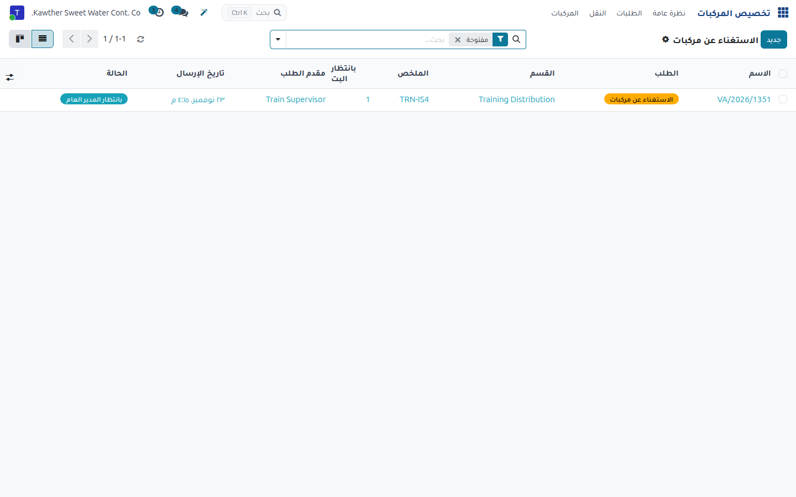
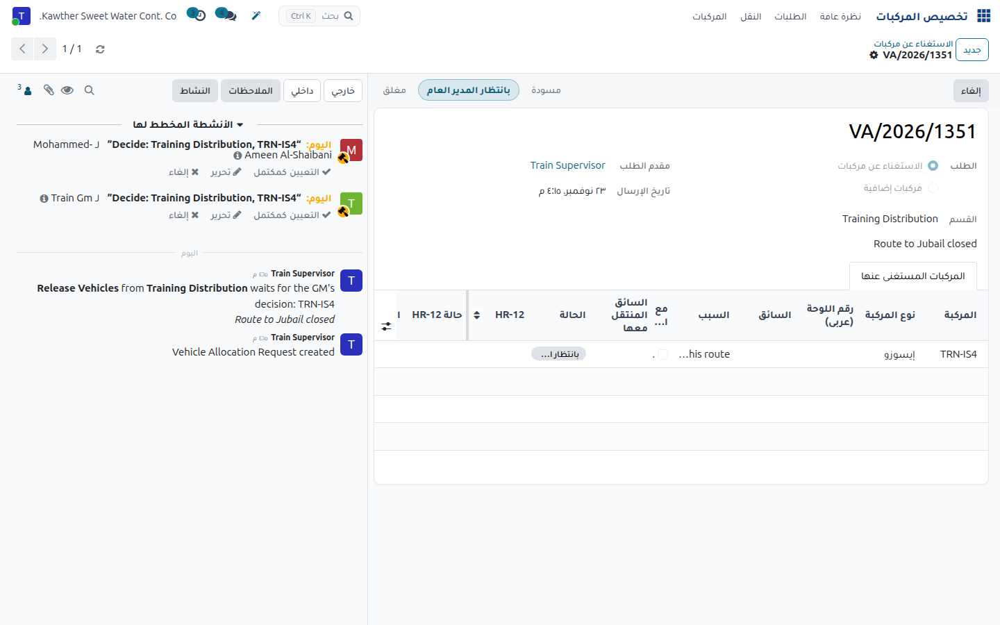
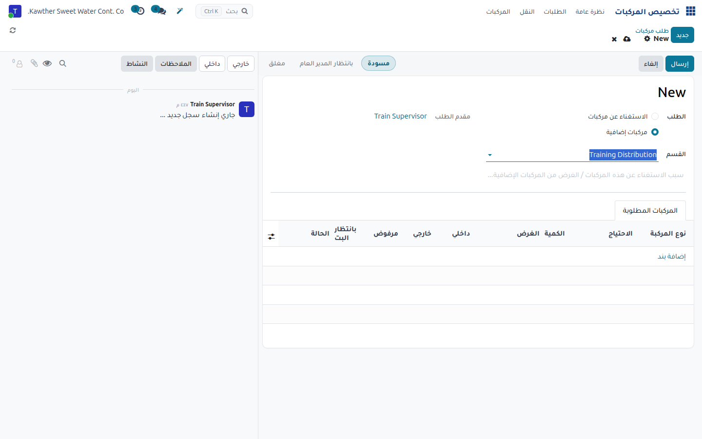

# الاستغناء عن المركبات وطلبها

**الفئة المستهدفة:** مشرفو الأقسام التي لديها مركبات (تخصيص المركبات، *مستخدم القسم*)
**الوقت المقدّر:** ٣ دقائق لكل طلب

## ما الذي تفعله هذه الشاشة

كل مركبة من مركبات الشركة تتبع قسمًا. إذا لم يعد قسمك يحتاج مركبة فإنك
**تستغني** عنها، وإذا احتاج مركبات أكثر فإنك **تطلبها**. وكلاهما **طلب** فقط:
**المدير العام** وحده يبتّ في كل مركبة. أنت لا تنقل مركبة بنفسك، ولا تخرج مركبة
من قسم آخر ما لم يستغنِ عنها ذلك القسم.

| الطلب | ما تحدده أنت | ما يقرره المدير العام |
|---|---|---|
| **الاستغناء عن مركبات** | المركبات التي تستغني عنها، والسبب، وهل يذهب السائق معها | منحها لقسم طلبها، أو إرسالها للورشة ثم الاحتياط، أو إبقاؤها لديك |
| **طلب مركبات** | العدد والنوع، وهل تحتاج السائق أيضًا | منح مركبات مستغنى عنها أو من الاحتياط، أو توفيرها من الخارج (شراء/استئجار)، أو الرفض |

## قبل أن تبدأ

- تحتاج صلاحية **تخصيص المركبات ← مستخدم القسم** لقسمك (أو أقسامك). إذا لم
  يظهر تطبيق **تخصيص المركبات** فاطلبها من مسؤول النظام.
- ترى مركبات **قسمك فقط** وتستغني عنها.

## الاستغناء عن مركبات

1. **افتح تخصيص المركبات ← الطلبات ← الاستغناء عن مركبات.** تعرض القائمة طلباتك
   وحالتها.
   

2. **اضغط جديد.** يظهر **القسم** تلقائيًا (اختره إذا كنت مسؤولًا عن أكثر من قسم).
   واكتب **السبب** في الخانة أسفله.

3. **أضف كل مركبة** في **المركبات المستغنى عنها**: **المركبة**، وفي **السبب**
   سببًا مختصرًا لها. ضع علامة **مع السائق** فقط إذا كان السائق سينتقل مع المركبة
   إلى القسم الذي سيستلمها (تبقى في عهدته ويُنقل معها).

4. **اضغط إرسال.** ينتقل الطلب إلى **بانتظار المدير العام**، ويظهر للمدير العام في
   صفحته الرئيسية.
   

## طلب مركبات

1. **افتح تخصيص المركبات ← الطلبات ← طلب مركبات** واضغط **جديد**.
   

2. **أضف سطرًا لكل نوع** في **المركبات المطلوبة**: **نوع المركبة**، **الاحتياج**،
   **الكمية**، **الغرض**:

   | الاحتياج | اختره عندما |
   |---|---|
   | **مركبة فقط** | يكون لديك سائق لها |
   | **مركبة مع سائق** | تحتاج السائق أيضًا |
   | **أيهما** | يناسبك الأمران |

3. **اضغط إرسال.**

## ماذا يحدث بعد ذلك

- **المدير العام يبتّ في كل مركبة.** يبقى الطلب **بانتظار المدير العام** حتى يُبتّ في
  كل سطر، ثم يصبح **مغلق**. ولكل سطر **حالة** خاصة به (تحويل، إلى الورشة / الاحتياط،
  أُبقيت لدى القسم…).
- **المركبة التي تخرج من قسمك** تذهب إلى الورشة بنموذج **تسليم (استغناء)** (HR-12):
  تفحصها الورشة وتراجع الموارد البشرية مستنداتها، وتُخلى العهدة عند اكتمال الاثنين.
- **المركبة التي تأتي إلى قسمك** تصل بنموذج **استلام**. ستجد في صفحتك الرئيسية مهمة
  *حدد السائق الجديد*: افتح النموذج، واختر **المستخدم الجديد**، واضغط **إرسال إلى
  الموارد البشرية**. تراجع الموارد البشرية رخصته، ثم تسلّم الورشة المركبة، وهذا هو
  وصولها إلى قسمك. وتنطبق على هذا السائق شروط [تغيير سائق المركبة](12-driver-change.md).
- **مع السائق**: لا ورشة ولا نموذج؛ تنتقل المركبة وسائقها معًا يوم قرار المدير العام،
  ويُنفَّذ نقل السائق.

## مشكلات شائعة

| المشكلة | السبب | الحل |
|---|---|---|
| المركبة لا تظهر عند الاستغناء | ليست من مركبات قسمك، أو مدرجة في استغناء آخر، أو في طريقها إلى قسم | راجع **تخصيص المركبات ← المركبات**؛ المركبة المنقولة تكمل انتقالها أولًا |
| لا أستطيع تعديل طلبي | تم إرساله | اكتب في المحادثة؛ ويمكن للمدير العام إعادته إلى مسودة |
| «بانتظار المدير العام» منذ أيام | لم يبتّ المدير العام بعد | الطلب في صفحته الرئيسية؛ تواصل معه |

## أدلة ذات صلة

- [تغيير سائق المركبة](12-driver-change.md)
- [الاستغناء عن الموظفين وطلبهم](13-release-and-request-employees.md)
- [المستندات الناقصة: الطلب من الموارد البشرية](14-document-requests.md)

