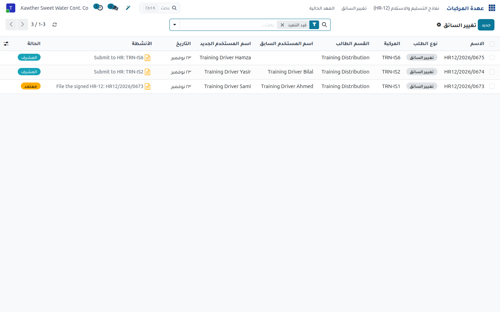
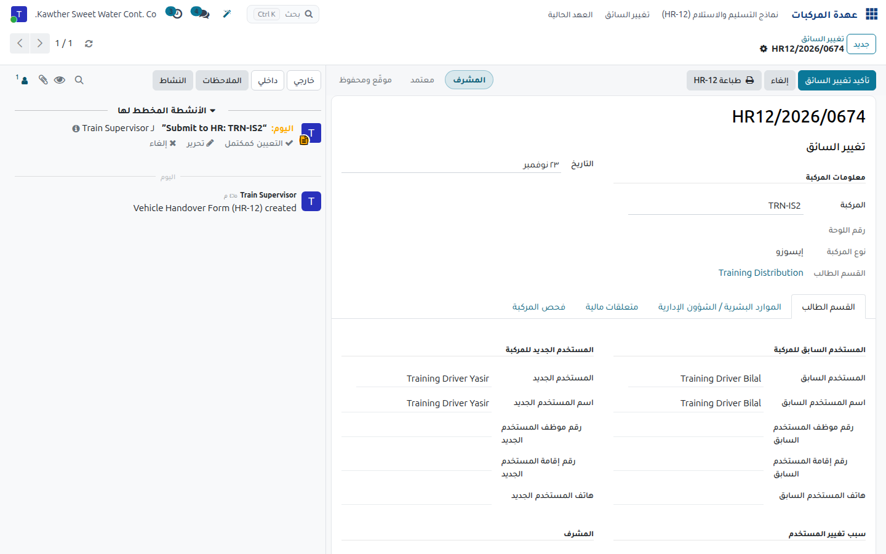
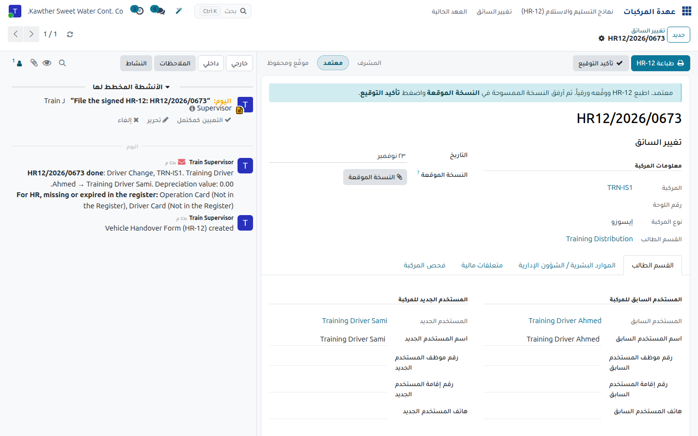
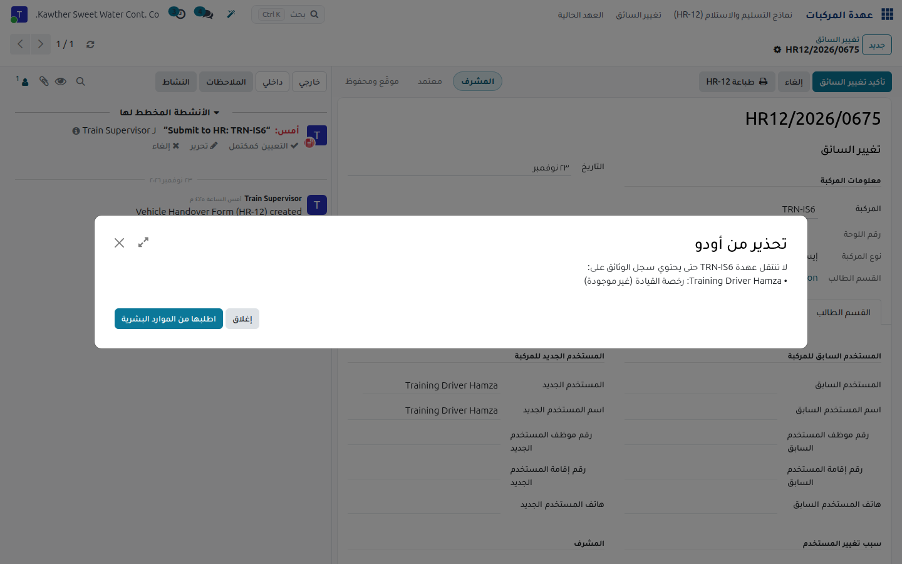
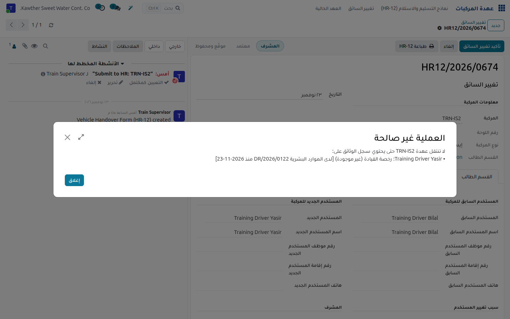

# تغيير سائق المركبة (HR-12)

**الفئة المستهدفة:** مشرفو الأقسام (تخصيص المركبات، *مستخدم القسم*)
**الوقت المقدّر:** دقيقتان

## ما الذي تفعله هذه الشاشة

تنقل إحدى مركبات قسمك من سائقها الحالي إلى سائق آخر **من قسمك نفسه**: إجازة،
إيقاف عن العمل، مسار جديد. وهو قرار قسمك وحده: لا يمر على المدير العام، ولا فحص
ورشة، ولا خطوة للموارد البشرية. عندما تنجح جميع الشروط يسلّم زر **تأكيد تغيير
السائق** المركبة للسائق الجديد فورًا، وتُبلَّغ الموارد البشرية والحسابات.

## قبل أن تبدأ

يتحقق النظام من الشروط التالية قبل انتقال العهدة، ولا تعرض قائمة **المستخدم
الجديد** إلا من يستوفي الشروط الأربعة الأولى:

| الشرط | السبب |
|---|---|
| **سائق واحد لمركبة واحدة**: ليس في عهدته مركبة مقودة | السائق يقود شاحنة واحدة في وقت واحد (التيدر لا يُحسب: يتبع الرأس) |
| ليس السائق الجديد في نموذج تسليم أو خطة أخرى | حتى لا يُوعد أحد بمركبتين |
| ليس مستغنى عنه هو نفسه | فهو مغادر |
| من **قسمك** | تغيير السائق يبقى داخل القسم |
| **سجل الوثائق** يحتوي **رخصة قيادة** سارية له، من فئة تناسب المركبة (نقل ثقيل للتريلا)، وأوراق المركبة (الاستمارة، التأمين، الفحص الدوري، بطاقة التشغيل، رخصة الصهريج) | لا تنتقل المركبة نظاميًا بدونها |

## الخطوات

1. **افتح عهدة المركبات ← تغيير السائق** واضغط **جديد**.
   

2. **اختر المركبة.** يظهر **المستخدم السابق** تلقائيًا، وهو صاحب العهدة الحالي.

3. **اختر المستخدم الجديد** من القائمة، وحدد **سبب تغيير المستخدم**، وأضف ملاحظة
   إن لزم.
   

4. **اضغط تأكيد تغيير السائق** ثم أكّد. إذا كان كل شيء سليمًا ينتقل النموذج إلى
   **معتمد**، وتصبح المركبة في عهدة السائق الجديد.
   

5. **اطبع HR-12** (زر **طباعة HR-12**)، وأكمل التواقيع، وامسحه ضوئيًا، وأرفقه في
   **النسخة الموقعة** ثم اضغط **تأكيد التوقيع**. ستبقى تذكرة في صفحتك الرئيسية حتى تفعل.

## عندما تكون المستندات ناقصة

إذا كان السجل ينقصه مستند يُرفض النموذج مع قائمة بما ينقص، وزر **اطلبها من الموارد
البشرية**:

اضغط **اطلبها من الموارد البشرية**: يذهب طلب لكل مستند ناقص إلى الموارد البشرية،
وتتابعها من **طلبات الوثائق الخاصة بي** (انظر [المستندات الناقصة: الطلب من الموارد
البشرية](14-document-requests.md)). وعندما تسجّلها الموارد البشرية تصلك رسالة؛ أكّد
تغيير السائق مرة أخرى.

وإذا سبق أن طلبتها فستذكر الرسالة ذلك مع رقم الطلب:

أما الرخصة من **فئة غير مناسبة** (رخصة خاصة لتريلا) فتُرفض دون الزر، لأن الموارد
البشرية لا تستطيع إصلاحها بالتسجيل. اختر سائقًا آخر.

## ماذا يحدث بعد ذلك

- تصل الموارد البشرية رسالة بإتمام التغيير، وفيها ما ينقص سجل المركبة إن وُجد، للعلم.
- تصل الحسابات نسخة (المتعلقات المالية، قيمة الإهلاك).
- يظهر السائق الجديد في سجل العهد (**عهدة المركبات ← العهد الحالية**) من اليوم.

## مشكلات شائعة

| المشكلة | السبب | الحل |
|---|---|---|
| السائق لا يظهر في قائمة **المستخدم الجديد** | لديه مركبة، أو موعود بمركبة، أو مستغنى عنه، أو ليس من قسمك | سلّم مركبته أولًا أو اختر سائقًا آخر |
| «… صاحب عهدة …، وهذا الحد المسموح له» | لديه مركبة | كما سبق. ويمكن للموارد البشرية السماح بمركبة ثانية مع ذكر السبب |
| «للمركبة … نموذج مفتوح HR12/…» | للمركبة نموذج آخر مفتوح | أكمله أو **ألغه** أولًا |
| بدأت نموذجًا بالخطأ | ما زال مسودة | **إلغاء** (أعلى اليسار) |

## أدلة ذات صلة

- [الاستغناء عن المركبات وطلبها](11-release-and-request-vehicles.md)
- [المستندات الناقصة: الطلب من الموارد البشرية](14-document-requests.md)

