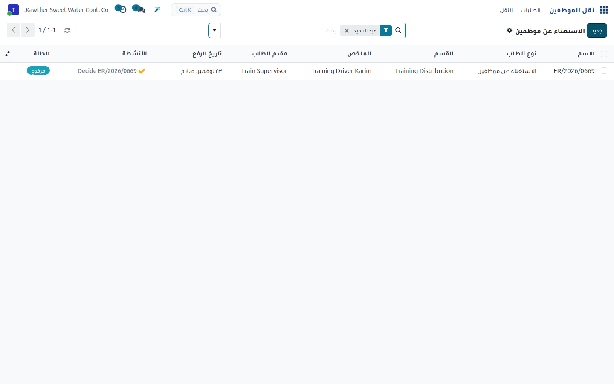
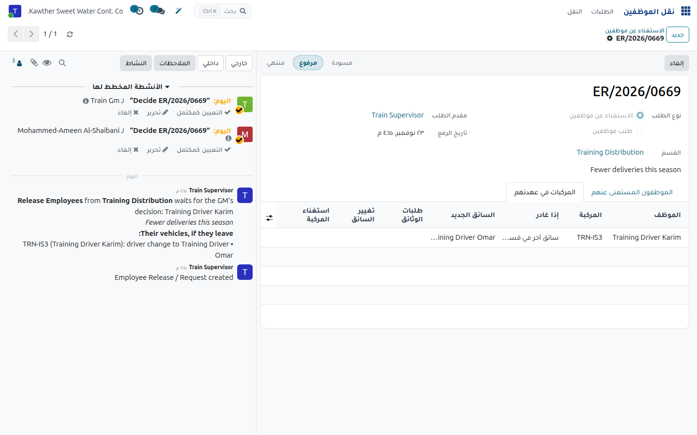
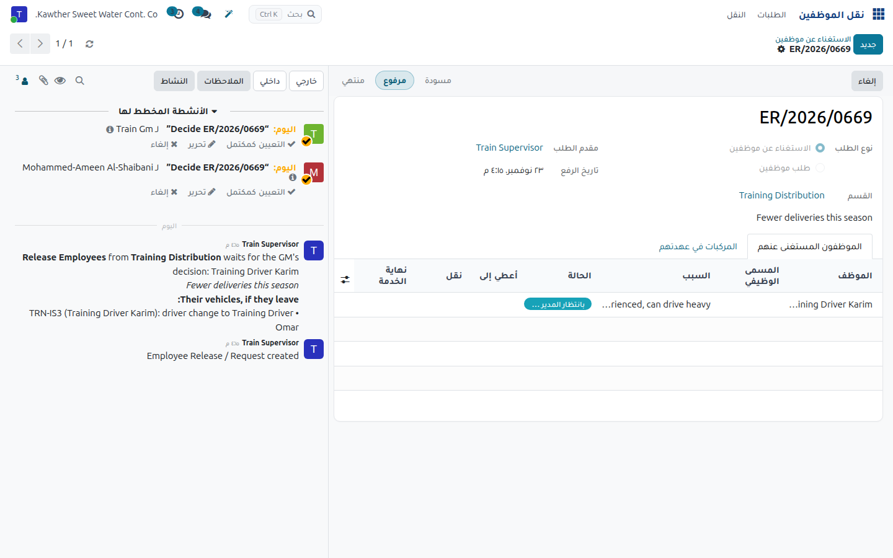

# الاستغناء عن الموظفين وطلبهم

**الفئة المستهدفة:** مدراء الأقسام (نقل الموظفين، *مقدم طلب*)
**الوقت المقدّر:** ٣ دقائق لكل طلب

## ما الذي تفعله هذه الشاشة

مثل المركبات تمامًا: قسمك **يستغني** عن موظفين لم يعد يحتاجهم، أو **يطلب** موظفين
(المسمى الوظيفي والعدد). **المدير العام** وحده يقرر: ينقل الموظف المستغنى عنه إلى قسم
طلبه، أو يعلّقه، أو ينهي خدمته، أو يرفض الاستغناء. ثم تنفّذ الموارد البشرية القرار.

## قبل أن تبدأ

- تحتاج صلاحية **نقل الموظفين ← مقدم طلب**، وتعمل للأقسام التي تديرها (وأقسامها الفرعية).
- إذا كان الموظف المستغنى عنه **صاحب عهدة مركبات**، تحدد أيضًا مصير كل مركبة إذا غادر.

## الاستغناء عن موظفين

1. **افتح نقل الموظفين ← الطلبات ← الاستغناء عن موظفين** واضغط **جديد**.
   

2. **اكتب السبب**، وفي **الموظفون المستغنى عنهم** أضف كل موظف مع **السبب** (ما يحتاج
   المدير العام معرفته عنه).

3. **احفظ.** إذا كان الموظف صاحب عهدة مركبات يظهر تبويب **المركبات في عهدتهم** بسطر
   لكل مركبة. حدد لكل منها **إذا غادر**:

   | إذا غادر | ما يحدث عند مغادرته |
   |---|---|
   | **سائق آخر في قسمنا** | اختر **السائق الجديد**؛ تبقى المركبة لديك (تغيير سائق) |
   | **استغناء إلى الورشة** | يُرفع استغناء عن المركبة إلى المدير العام |

   تتبع قائمة **السائق الجديد** شروط [تغيير سائق المركبة](12-driver-change.md): مركبة
   واحدة لكل سائق، وليس مغادرًا، ورخصة سارية. والمستند الناقص يوقف الرفع مع زر
   **اطلبها من الموارد البشرية**.
   

4. **اضغط رفع إلى المدير العام.** يصبح الطلب **مرفوع**، ويرى المدير العام خطة المركبات معه.
   

> **لا يحدث شيء للمركبات قبل أن يغادر فعلًا.** إذا أبقاه المدير العام تُلغى الخطة، وإذا
> نُقل أو انتهت خدمته تُنفَّذ الخطة في ذلك اليوم.

## طلب موظفين

1. **افتح نقل الموظفين ← الطلبات ← طلب موظفين** واضغط **جديد**.
2. **أضف سطرًا لكل وظيفة**: **المسمى الوظيفي**، والعدد، وملاحظة.
3. **اضغط رفع إلى المدير العام.**

## ماذا يحدث بعد ذلك

- يبتّ المدير العام في كل موظف. يذهب النقل إلى الموارد البشرية، فتحدد مديره الجديد
  والمعتمدين وتنفّذه في تاريخ النفاذ. وإذا كان لا يزال صاحب عهدة مركبة فإن النقل ينتظر
  حتى تُسلَّم.
- وفي طلب الموظفين قد يعطيك المدير العام موظفين مستغنى عنهم، أو تعيّن الموارد البشرية من الخارج.

## مشكلات شائعة

| المشكلة | السبب | الحل |
|---|---|---|
| «… صاحب عهدة TRN-…: حدد في المركبات في عهدتهم ما يحدث لها إذا غادر» | مركبة بلا خطة | افتح التبويب وحدد **إذا غادر** |
| الموظف لا يظهر في القائمة | ليس في قسم تديره، أو مستغنى عنه مسبقًا | اطلب من الموارد البشرية مراجعة قسمه |
| السائق الجديد الذي أريده لا يظهر | لديه مركبة، أو مغادر، أو موعود بمركبة | انظر [تغيير سائق المركبة](12-driver-change.md) |

## أدلة ذات صلة

- [الاستغناء عن المركبات وطلبها](11-release-and-request-vehicles.md)
- [المستندات الناقصة: الطلب من الموارد البشرية](14-document-requests.md)

