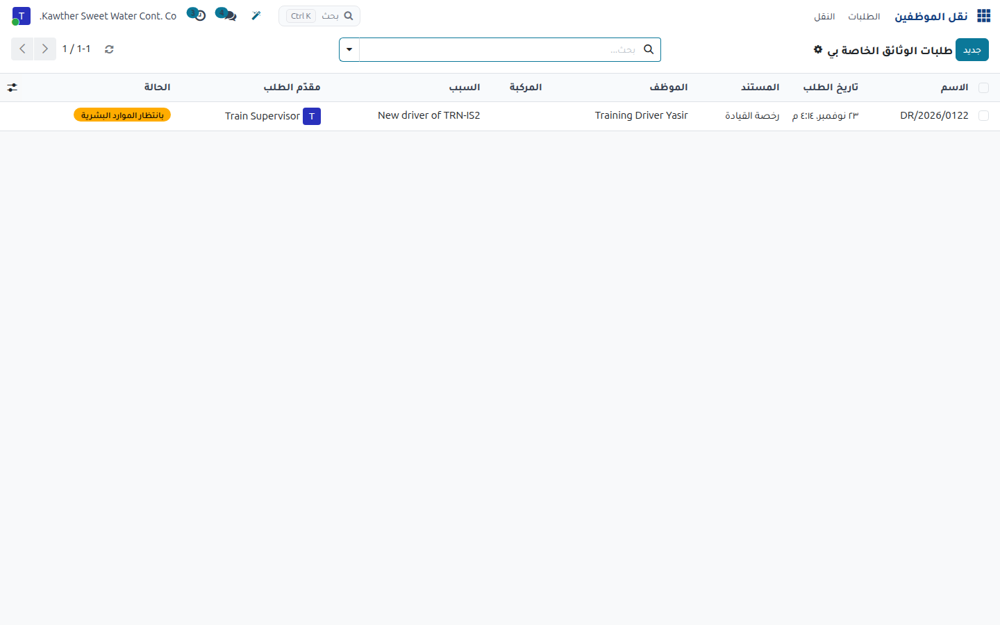
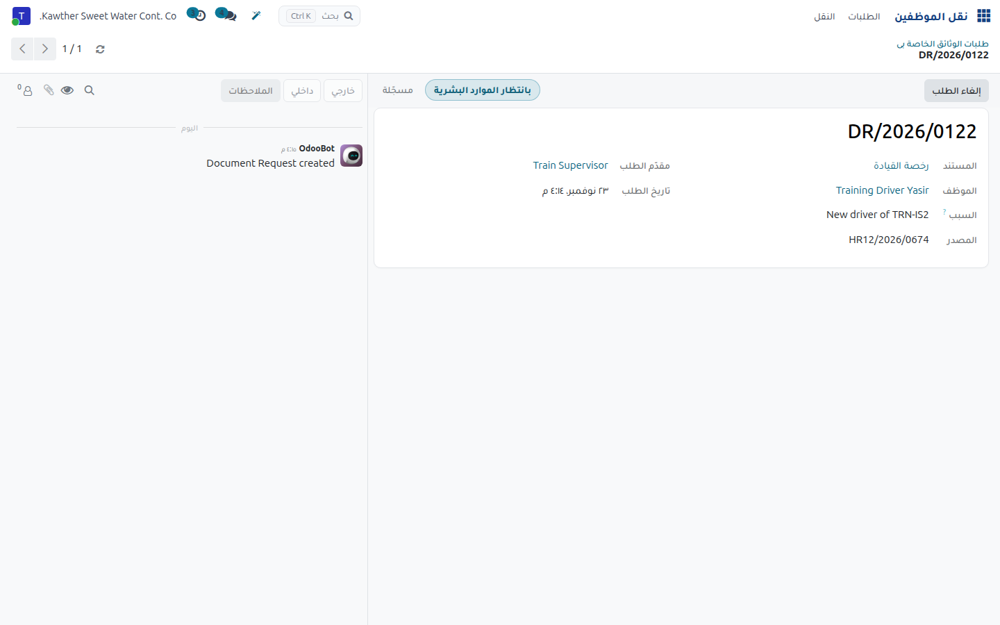

# المستندات الناقصة: الطلب من الموارد البشرية

**الفئة المستهدفة:** مشرفو الأقسام
**الوقت المقدّر:** دقيقة واحدة

## ما الذي تفعله هذه الشاشة

لا تنتقل عهدة مركبة ما دام **سجل الوثائق** ينقصه أحد أوراقها أو رخصة السائق الجديد.
السجل لدى الموارد البشرية ولا تطّلع عليه أنت. بدلًا من ذلك تحمل الرسالة التي توقفك زر
**اطلبها من الموارد البشرية**، ويصبح كل مستند ناقص **طلب وثيقة** (`DR/2026/…`) تتابعه بنفسك.

## الخطوات

1. **اضغط اطلبها من الموارد البشرية** في الرسالة (انظر [تغيير سائق
   المركبة](12-driver-change.md)). تؤكد رسالة خضراء أرقام الطلبات.

2. **تابعها** من **نقل الموظفين ← الطلبات ← طلبات الوثائق الخاصة بي**، أو من تبويب
   **المركبات في عهدتهم** في طلب الاستغناء (عمود **طلبات الوثائق**).
   

3. **افتح أحدها** لترى المطلوب وسببه وحالته.
   

| الحالة | المعنى |
|---|---|
| **بانتظار الموارد البشرية** | الطلب في الصفحة الرئيسية للموارد البشرية |
| **مسجّلة** | سجّلت الموارد البشرية الوثيقة ووصلتك رسالة. أعد الرفع أو التأكيد |
| **ملغي** | ألغيته أنت أو الموارد البشرية |

## الاطلاع على المستندات بنفسك

**عهدة المركبات ← المستندات** تعرض للاطلاع فقط مستندات مركبات **وموظفي** أقسامك: الرخص،
الإقامات، الاستمارات، التأمين، مع تواريخ انتهائها. لا يمكنك تعديلها؛ الموارد البشرية تتولى ذلك.

## ماذا يحدث بعد ذلك

يُغلق الطلب تلقائيًا لحظة وجود وثيقة سارية في السجل، سواء أدخلتها الموارد البشرية من
طلبك أو وصلت مع ملف من البوابات الحكومية. لا تحتاج إلى المتابعة: ستصلك رسالة.

## مشكلات شائعة

| المشكلة | السبب | الحل |
|---|---|---|
| «[لدى الموارد البشرية DR/… منذ …]» في الرسالة | سبق أن طلبتها أنت أو مشرف آخر | انتظر رسالة التسجيل |
| طلبتها بالخطأ | ما زالت بالانتظار | افتحها واضغط **إلغاء الطلب** |

