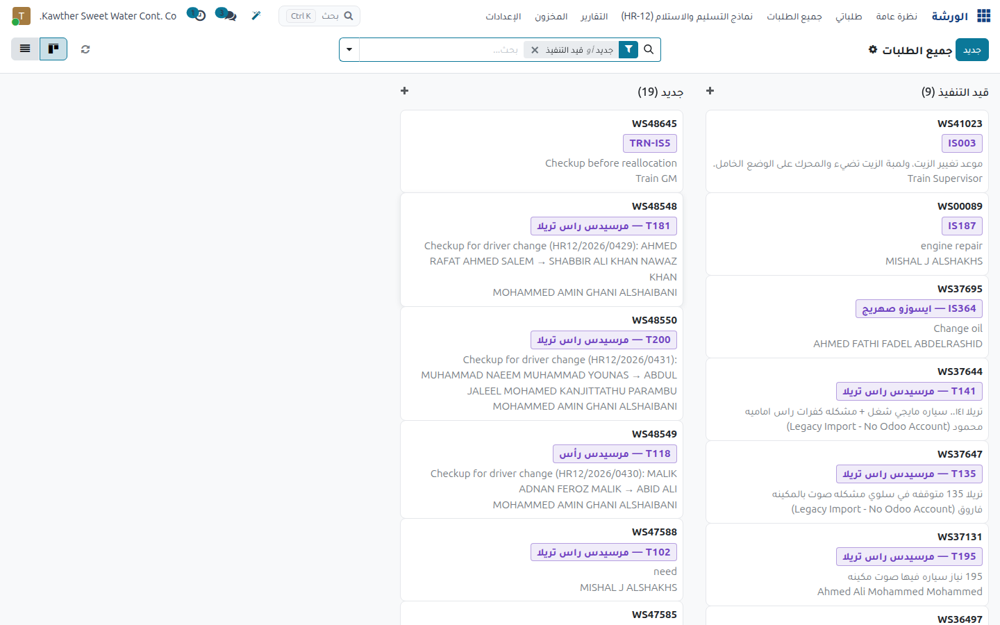
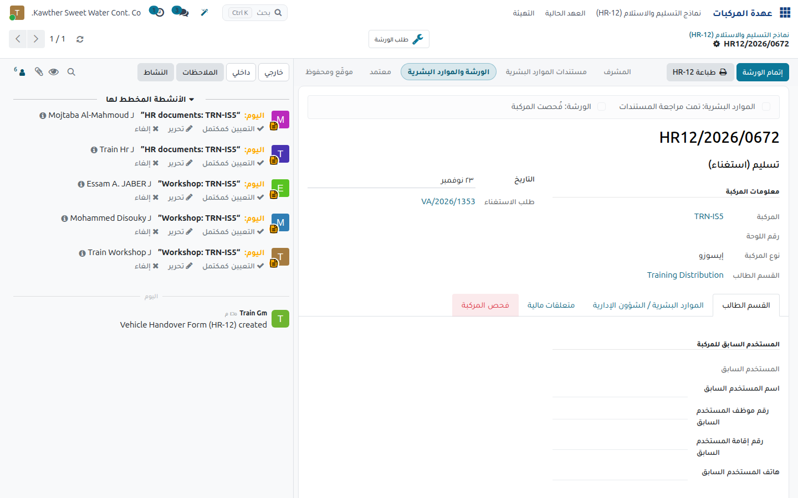
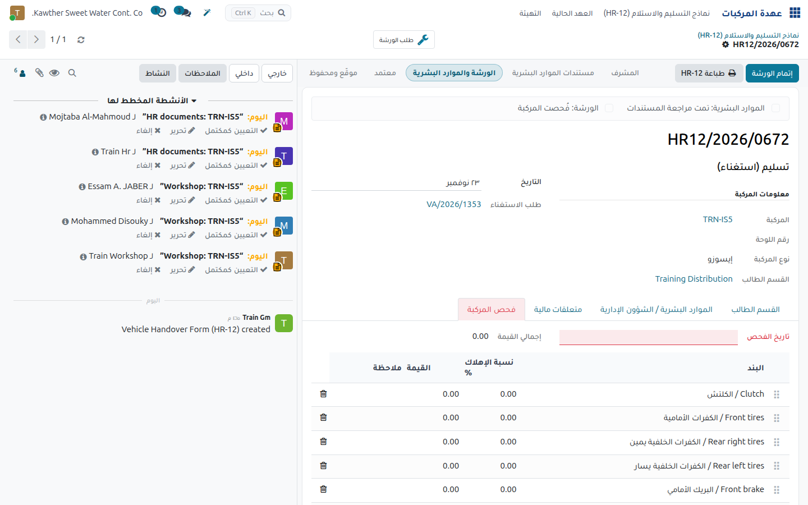

# قائمة مدير الورشة والمواقع ونماذج التسليم

**الفئة المستهدفة:** مدراء الورش والفنيون
**الوقت المقدّر:** عمل يومي

## ما الذي تفعله هذه الشاشة

هناك ثلاث ورش: **النابية** (الرئيسية)، و**تبوك**، و**الحياة**. يذهب كل طلب إلى إحداها، وتعمل
أنت على طلبات ورشتك **فقط**. وإلى جانب طلبات الإصلاح، للورشة خطوة في **نماذج التسليم والاستلام
(HR-12)**: فحص المركبة المسلَّمة، وتسليم المركبة لقسمها الجديد.

## قبل أن تبدأ

- أنت ضمن **المدراء والموظفون** في ورشتك (**الورشة ← الإعدادات ← الورش**). إن لم تكن في أي ورشة
  فلن ترى شيئًا: راجع مسؤول النظام.
- المدير العام والمراجعون يرون كل الورش، ويتنقلون بينها في لوحة البيانات.

## إلى أين يذهب الطلب

يذهب الطلب إلى الورشة التي **تخدم قسم مقدم الطلب** (أو أقرب قسم أعلى منه)، وإلا فإلى النابية.
والطلبات التي قُدّمت قبل وجود الورش الثلاث تتبع النابية.

1. **افتح الورشة ← جميع الطلبات.** يعرض عمود **الورشة** الموقع، ولا ترى إلا طلبات ورشتك.
   

2. اعمل على الطلبات كالمعتاد: القبول (قيد التنفيذ)، وتعبئة تقرير الإصلاح، ثم **الإكمال** أو
   **الرفض**. وانظر دليل مقدم الطلب [تقديم طلب خدمة الورشة](../supervisor/10-workshop-request.md)
   لما يراه هو.

## نماذج التسليم والاستلام (HR-12)

افتحها من صفحتك الرئيسية (*الورشة: TRN-…*) أو من **عهدة المركبات ← نماذج التسليم والاستلام (HR-12)**.

| النموذج | دورك |
|---|---|
| **تسليم (استغناء)** | فحص المركبة المسلَّمة، **بالتوازي** مع مراجعة الموارد البشرية لمستنداتها. ويُفتح معه **طلب الورشة** للفحص (زر في الأعلى) |
| **استلام** | بعد مراجعة الموارد البشرية للسائق الجديد، سلّمه المركبة: **وهذا وصولها** إلى القسم الجديد |

1. **افتح تبويب فحص المركبة.** أدخل **تاريخ الفحص**، ولكل عنصر (الكلتش، الكفرات، البريك…) **نسبة
   الإهلاك %** و**القيمة** وملاحظة. و**إجمالي القيمة** هو ما يصل إلى الحسابات.
   

2. **اضغط إتمام الورشة.** في التسليم يصبح النموذج **معتمد** متى راجعت الموارد البشرية المستندات
   أيضًا؛ وفي الاستلام هو الوصول: المركبة للقسم والسائق من الآن.

> تغيير السائق بين سائقين من القسم نفسه **لم تعد فيه خطوة للورشة**.

## مشكلات شائعة

| المشكلة | السبب | الحل |
|---|---|---|
| القائمة فارغة | لست ضمن أي ورشة | اطلب من مسؤول النظام إضافتك إلى ورشتك |
| ذهب طلب إلى ورشة خطأ | قسم مقدم الطلب تخدمه ورشة أخرى، أو لا تخدمه أي ورشة (فيذهب للنابية) | يضبط مسؤول النظام **الأقسام المخدومة** في **الورشة ← الإعدادات ← الورش** |
| لا يظهر زر **إتمام الورشة** في الاستلام | لم تراجع الموارد البشرية السائق بعد | يظهر بعد **تمت مراجعة المستندات** |

