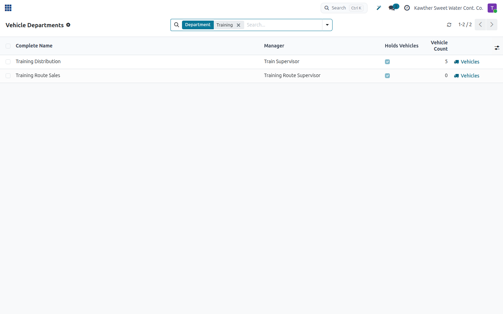
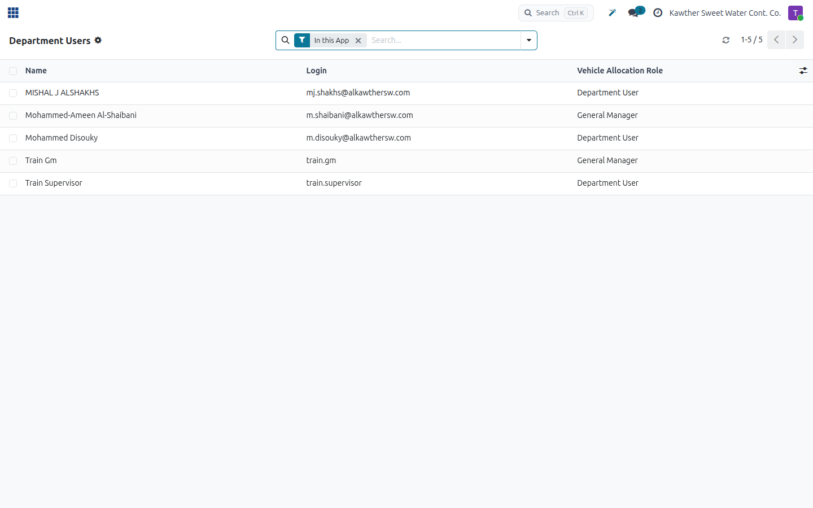
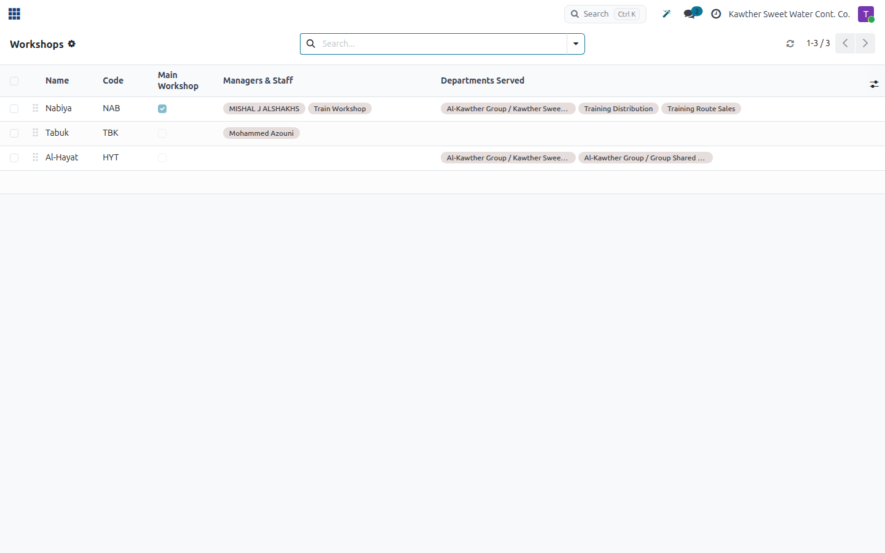

# Setting Up Vehicles, Custody, Transfers and Documents

**Who is this for:** the system administrator
**How long it takes:** one sitting at go-live, then as people change

## What this does

The apps need four kinds of setup: **who answers for which department**,
**which departments hold vehicles and which workshop serves them**, **who
works in which workshop**, and **what a handover checks**. Do them in this
order at go-live.

## 1. Vehicle-holding departments

**Vehicle Allocation → Configuration → Vehicle Departments.** Tick **Holds
Vehicles** for the departments that answer for vehicles; **Vehicle Count**
shows how many each has. Every company vehicle needs a department:
**Vehicle Allocation → Vehicles**, filter *No department*.

## 2. Who answers for which department

**Vehicle Allocation → Configuration → Department Users.** Give each
supervisor the **Department User** role and his department(s). The GM gets
**General Manager**, which sees and decides every department.

For **Employee Transfers**, a **Requester** acts for the departments he
**manages** (the department's *Manager*): keep the managers correct in
Employees → Departments.

## 3. Workshops: staff and the departments they serve

**Workshop → Configuration → Workshops.** For each workshop, add its
**Managers & Staff**, and in **Departments Served** the departments whose
requests it receives (a sub-department follows its parent; a department
served by none goes to Nabiya, the main workshop). Someone in no workshop
sees no queue.

## 4. What a handover checks

**Documents → Configuration → Document Types**, column **Checked at Vehicle
Handover**. A required document of the vehicle or the new driver that is
missing or expired stops a handover. Switch a type on only when the register
holds it for everyone (import first), or every handover stops.

## Roles at a glance

| Role (Settings → Users) | Give it to |
|---|---|
| Vehicle Allocation: **Department User** (+ departments) | each vehicle-holding department's supervisor |
| Vehicle Allocation: **General Manager** | the GM |
| Employee Transfers: **Requester** | department managers |
| Employee Transfers: **HR** / **General Manager** | HR / the GM |
| Vehicle Custody: **HR / Administrative Affairs** (includes Documents Officer) | HR / Administrative Affairs |
| Vehicle Custody: **Accounting (Information Copy)** | the accountant who follows vehicle depreciation |
| Workshop: **Manager** / **Technician** (+ workshops) | workshop staff |
| Fleet: **Couple Tedders to Heads** / **Edit Tedder Data** | the dispatcher / HR |
