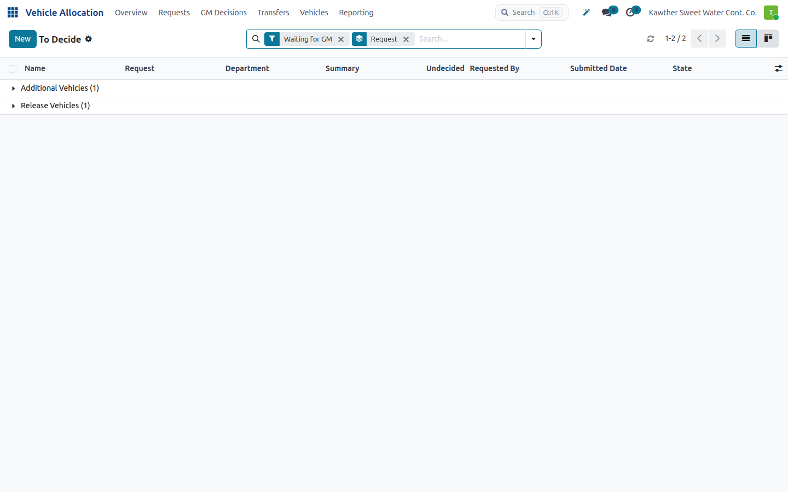
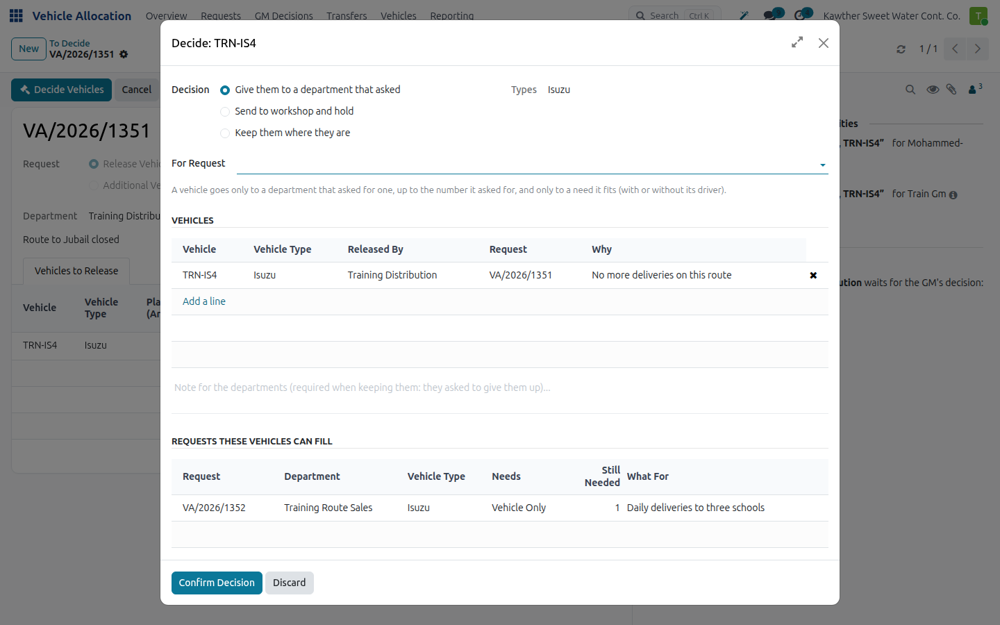
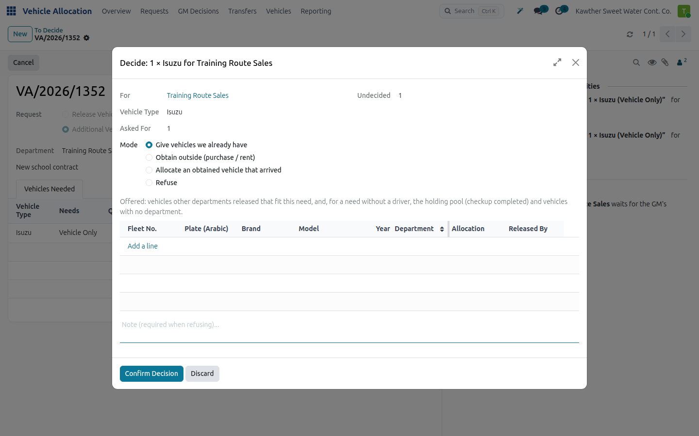

# Deciding Vehicle Requests

**Who is this for:** General Manager (Vehicle Allocation, *General Manager*)
**How long it takes:** 1 minute per vehicle

## What this does

Departments **release** vehicles and **request** vehicles; you are the only
one who decides. You decide each vehicle, from the request itself. Everything
after your decision (the workshop, HR's checks, the handover form) is
execution and needs nothing more from you.

## Before you start

- Every request waiting for you is on your **Home** page and in **Vehicle
  Allocation → GM Decisions → Requests to Decide**.
  

## Deciding a release

1. **Open the request** and click **Decide Vehicles**.

2. **Choose the Decision** for the vehicles listed:

   | Decision | Effect |
   |---|---|
   | **Give them to a department that asked** | choose **For Request**: only open requests of the same type, with room, and a need that fits (with or without driver) are offered. The vehicle goes to the workshop for a checkup, then to that department |
   | **Send to workshop and hold** | the vehicle goes to the workshop and waits in the **Holding Pool** for a future request |
   | **Keep them where they are** | the department keeps it. Write why in the note (they asked to give it up) |

   The lower table, **Requests These Vehicles Can Fill**, shows what is open.
   

3. **Click Confirm Decision.**

## Deciding a request for vehicles

1. **Open the request** and click **Decide** on the line.
2. **Choose the Mode**:

   | Mode | Effect |
   |---|---|
   | **Give vehicles we already have** | pick from vehicles other departments released that fit, or the holding pool (checkup completed) |
   | **Obtain outside (purchase / rent)** | the number to buy or rent; the line waits for them |
   | **Allocate an obtained vehicle that arrived** | gives a purchased or rented vehicle that has arrived |
   | **Refuse** | write why |

   

3. **Click Confirm Decision.**

## What happens next

The departments are told. A vehicle you give goes through the workshop and
the HR-12 handover forms; the receiving department names its driver. A
vehicle released **with its driver** moves at once with him.

## Common issues

| Symptom | Cause | Fix |
|---|---|---|
| **For Request** offers nothing | No open request fits (type, need, quantity, not the same department) | Hold it, or wait for a request |
| A release has no Decide button | It is not submitted yet, or already decided | Check its state |
