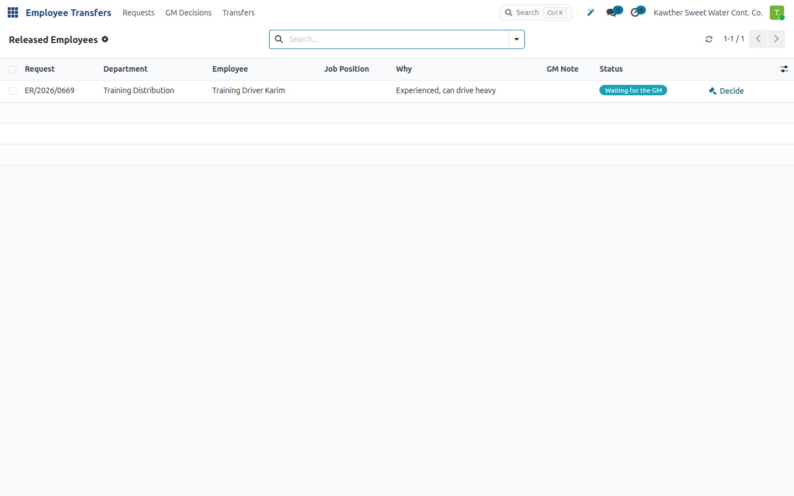
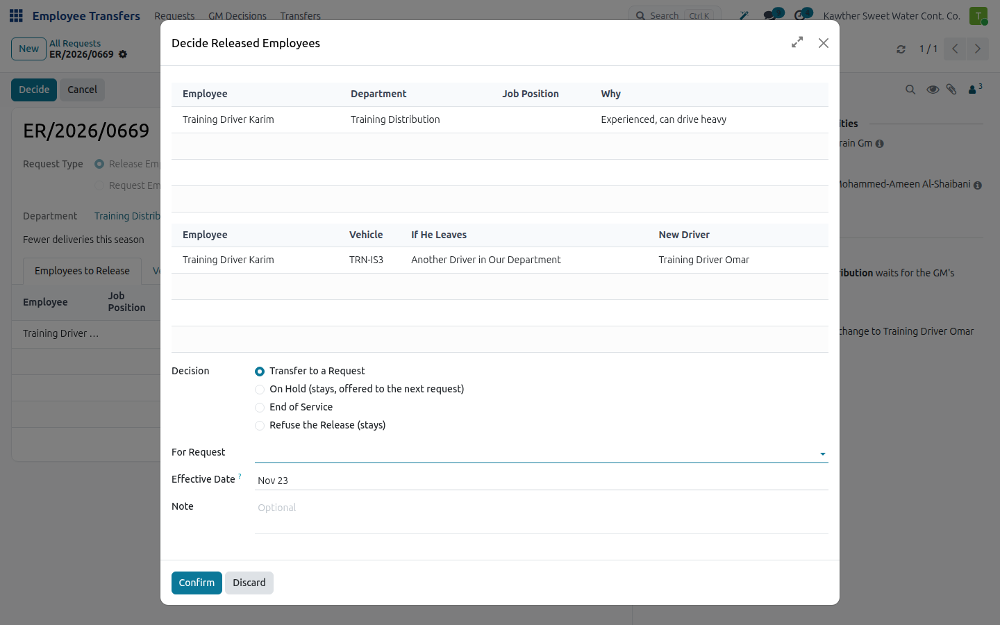
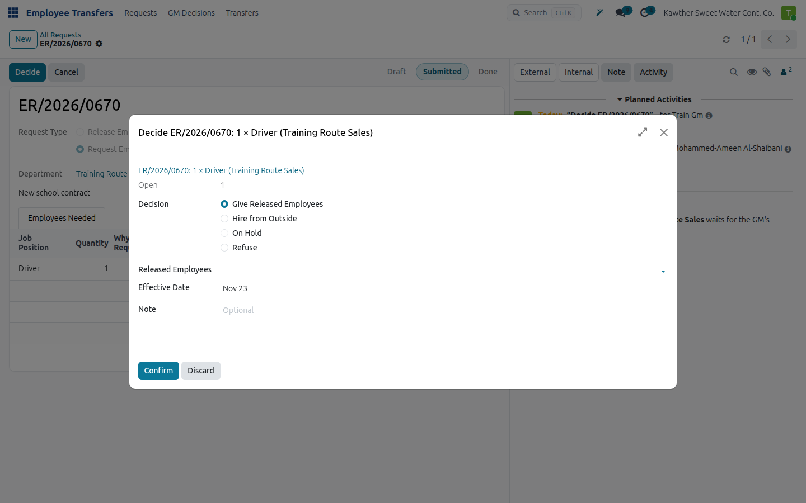

# Deciding Employee Releases and Requests

**Who is this for:** General Manager (Employee Transfers, *General Manager*)
**How long it takes:** 1 minute per employee

## What this does

Departments **release** employees and **request** employees; you decide.
For a released employee you also see what his department planned for the
**vehicles in his custody**, because your decision carries that plan out.

## Deciding a release

1. **Open the request** from your Home page or **Employee Transfers → GM
   Decisions → Released Employees**, and click **Decide**.
   

2. **Read both tables**: the employees, and **their vehicles, if they leave**
   (driver change to whom, or release to the workshop).

3. **Choose the Decision**:

   | Decision | Effect |
   |---|---|
   | **Transfer to a Request** | choose **For Request** (a department that asked for his job) and the **Effective Date**. HR completes the transfer |
   | **On Hold** | he stays and is offered to the next request |
   | **End of Service** | **Effective Date** = his termination date; HR completes it |
   | **Refuse the Release** | he stays; nothing happens to his vehicles |

   

4. **Click Confirm.** On a transfer or end of service, the vehicle plan runs
   now: a driver change is completed, a release to the workshop goes to
   Vehicle Allocation. If something in the plan is no longer valid (an
   expired licence, a driver taken meanwhile) the decision is stopped with
   the reason: return it to the department.

## Deciding a request for employees

1. **Open the request** and click **Decide** on the line.
2. **Give Released Employees** (choose them), **Hire from Outside**,
   **On Hold** or **Refuse**, with the number.
   
3. **Click Confirm.**

## What happens next

HR sets each transferred employee's new manager and approvers and applies
the transfer on its date; HR names the hires. The departments are told.
