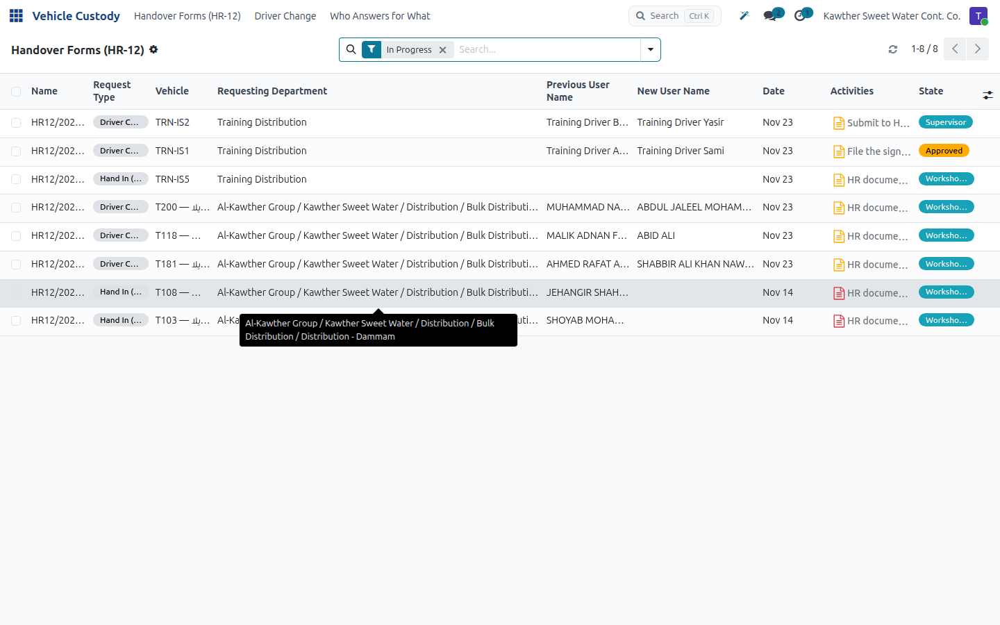
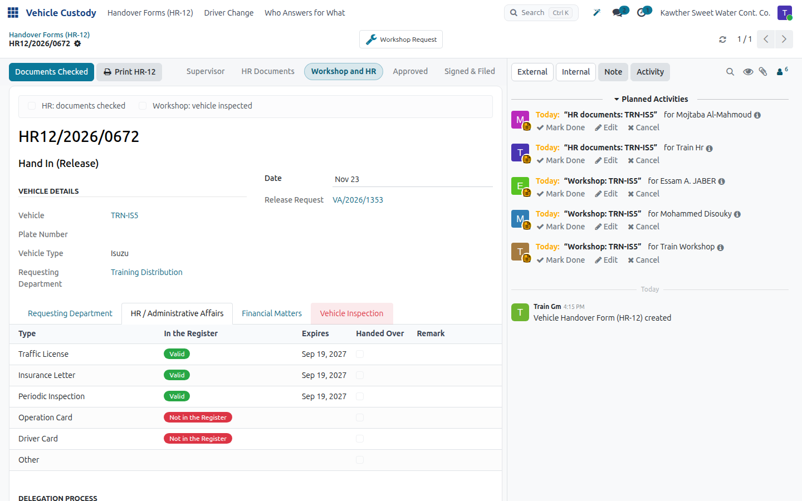
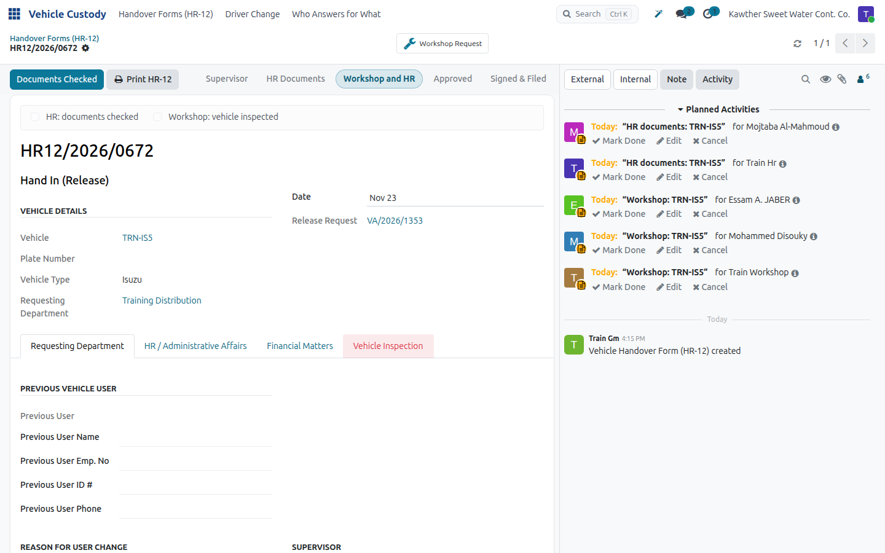

# HR-12: Checking a Handover's Documents

**Who is this for:** HR / Administrative Affairs (Vehicle Custody, *HR / Administrative Affairs*)
**How long it takes:** 2 minutes per form

## What this does

The handover form **HR-12** follows a vehicle when it changes hands. HR has
a step on two kinds of form; the GM already decided, so you complete your
section, you do not approve:

| Form | When | Your part |
|---|---|---|
| **Hand In (Release)** | a released vehicle goes to the workshop | check its documents are handed in, **in parallel** with the workshop's inspection |
| **Receive** | a department receives a vehicle and names its driver | check the new driver and the documents **before** the workshop hands it over |

A **Driver Change** inside a department has no HR step any more: it is done
when the supervisor confirms it, and you get a message listing anything the
register is missing, for information.

## Steps

1. **Open the form** from your Home page (*HR documents: …*) or **Vehicle
   Custody → Handover Forms (HR-12)**.
   

2. **Open the HR / Administrative Affairs tab.** Each document line shows
   what the **register** holds (Valid / Expiring Soon / Expired / Not in the
   Register) with its expiry, so you do not re-check it by hand. Tick
   **Handed Over** for what you received, and add remarks.
   

3. On a **Receive**, the new user's **licence type and expiry** are read from
   the register; the driver's checks (one vehicle, his department, a valid
   licence of the right class) run again.

4. **Click Documents Checked.** On a hand-in the form waits for the
   workshop if it has not finished; on a receipt it goes to the workshop,
   whose handover is the vehicle's arrival.
   

## What happens next

When the workshop is also done, the form is **Approved**: the custodian
changes, Accounting and the department are told. The department prints,
signs and files the paper.

## Common issues

| Symptom | Cause | Fix |
|---|---|---|
| No **Documents Checked** button | The form is not at your step | Check the status bar |
| "… cannot change hands until the documents register holds …" | The register lacks a document of the vehicle or driver | Register it (see [The documents register](07-documents-register.md)), then click again |
