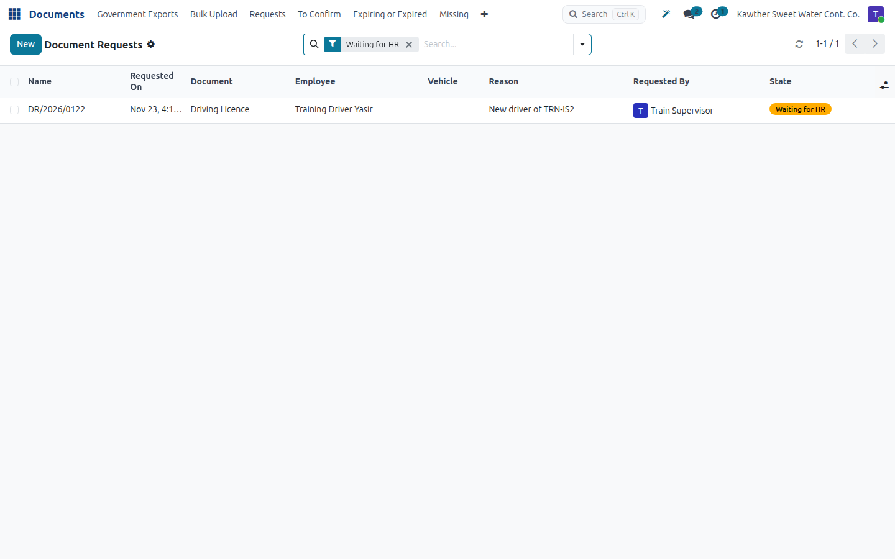
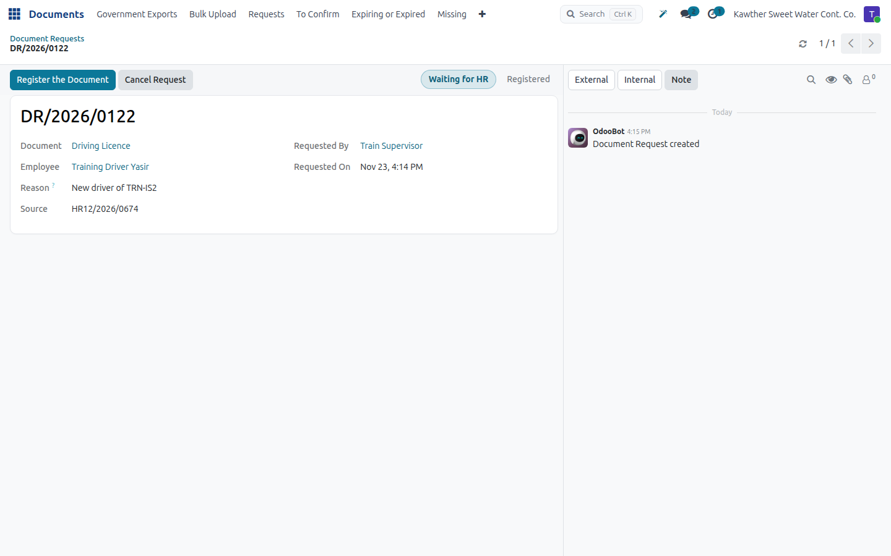
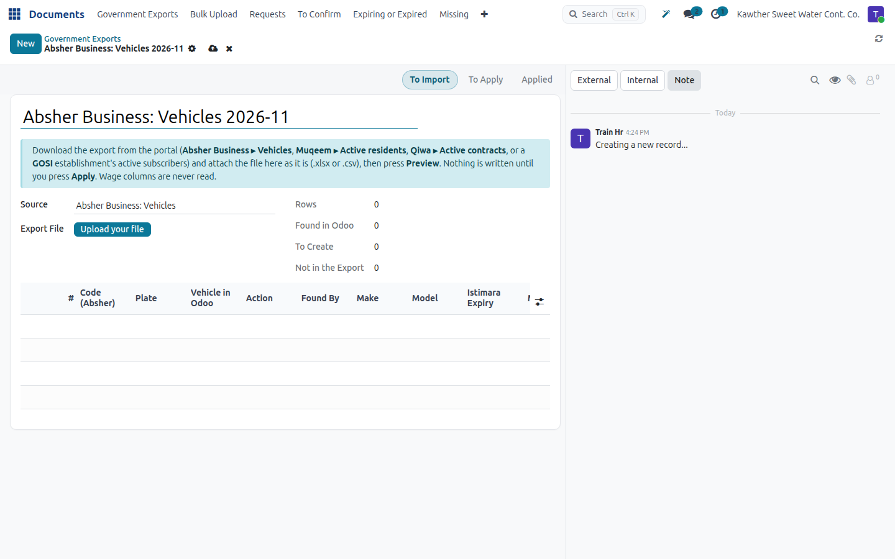
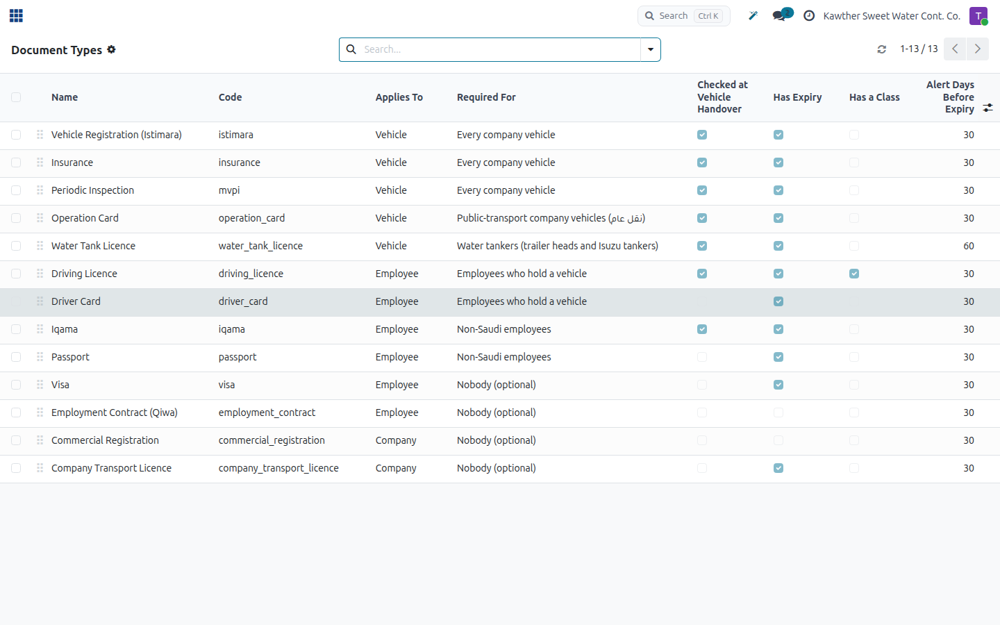

# The Documents Register and Document Requests

**Who is this for:** HR / Administrative Affairs (Documents, *Documents Officer*)
**How long it takes:** varies

## What this does

The **Documents** app is the one register of every vehicle's and employee's
papers: istimara, insurance, periodic inspection, operation card, tank
licence, driving licence, driver card, iqama, passport. Handovers read it:
**a vehicle cannot change hands while a checked document is missing or
expired.** Supervisors cannot see the register; when they need something in
it, they send you a **Document Request**.

## Answering document requests

1. **Open Documents → Requests** (also on your Home page as *Document
   requests*). Oldest first; each says what is needed, for whom, why
   (e.g. *New driver of TRN-IS2*) and who asked.
   

2. **Open the request and click Register the Document.** The document form
   opens already pointing at the employee or vehicle.
   

3. **Fill in the number and expiry** (attach the scan if you have it) and
   **Confirm**. The request closes itself and the supervisor is told.

> Any valid document of the same kind confirmed for that person or vehicle
> closes the request, however it was entered (upload, bulk upload, export).

## Importing government exports

The fastest way to fill the register. **Documents → Government Exports →
New**, choose the **Source**, attach the file, **Preview**, check the
warnings, then **Apply**. Nothing is written before Apply; nothing in Odoo is
overwritten by an older document.

| Source | From | Fills |
|---|---|---|
| **Absher Business: Vehicles** | Absher ▸ Vehicles | istimara, inspection, insurance status, actual user |
| **Absher Business: Driving Licence Holders** | Absher ▸ licence holders (residents) | driving licence: number = iqama, class, expiry |
| **Muqeem: Active Residents** | Muqeem ▸ active residents | iqama, passport |
| **Qiwa / GOSI** | the portals' lists | contracts, registration |
| **Tank Inspection Report (Fahes)** | the inspection report | water tank licence |

The licence preview also warns about a custodian of a trailer holding a
licence of the wrong class, and lists residents who hold a vehicle but have
no licence in the file.

## What a handover checks

**Documents → Configuration → Document Types**: the column **Checked at
Vehicle Handover** decides which documents stop a handover. The driver card
is off until the cards are registered for everyone; switch it on then.

## A driver who may hold two vehicles

One driver holds one driven vehicle. For an approved exception, open the
employee, tab **Vehicle Custody**, set **Vehicles He May Hold** to 2 and
write **Why More Than One**.

## Common issues

| Symptom | Cause | Fix |
|---|---|---|
| "This is the Absher driving licence export…" | The file was imported as Muqeem | Choose **Absher Business: Driving Licence Holders** |
| A row says *Not an employee in Odoo* | No employee has that iqama | Add the employee (iqama in SSN No.), preview again |
