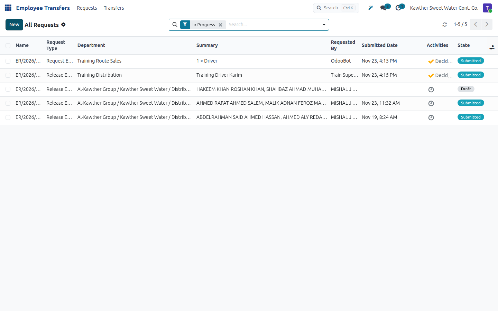

# Employee Transfers: HR's Part

**Who is this for:** HR (Employee Transfers, *HR*)
**How long it takes:** 3 minutes per transfer

## What this does

When the GM transfers a released employee, or ends his service, HR carries
it out. You do not decide; you complete what the move needs.

## Completing a transfer

1. **Open it** from your Home page or **Employee Transfers → Transfers**.
   It is **With HR**.
2. **Check the proposed new manager, time off approver, attendance approver
   and HR responsible**: they come from the new department. Correct them if
   needed (all required).
3. **Click Confirm.** It waits for its **effective date** (**Waiting for
   Date**) and is **Applied** that day: his department, manager and
   approvers change.

> **Vehicles first.** If he still answers for a vehicle, the transfer waits
> until the vehicle is handed over (the driver change or hand-in from his
> release plan), then applies at once.

If the transfer cannot go ahead, click **Return to the GM** with the reason.

## End of service and hires

- **End of Service** decided by the GM: open the release and click **End of
  Service** to start his end-of-service request with the termination date.
- **Hire from Outside**: when the new employees are created, open the
  request and click **Name New Hires**.
