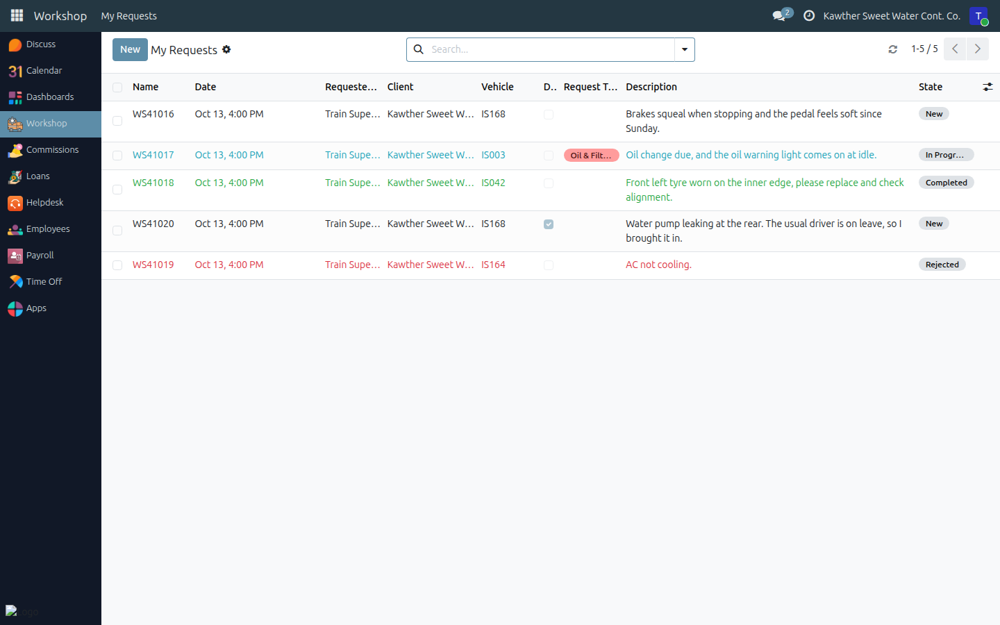
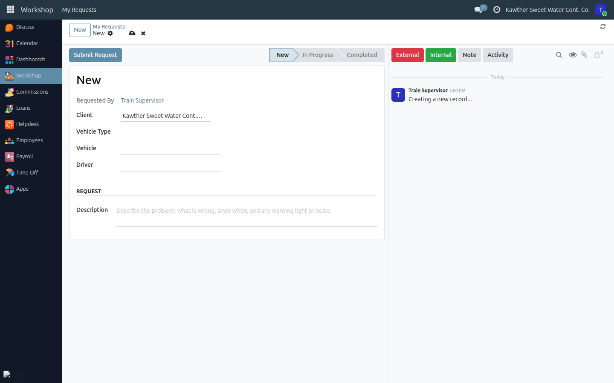
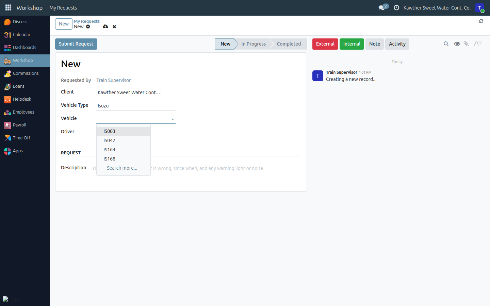
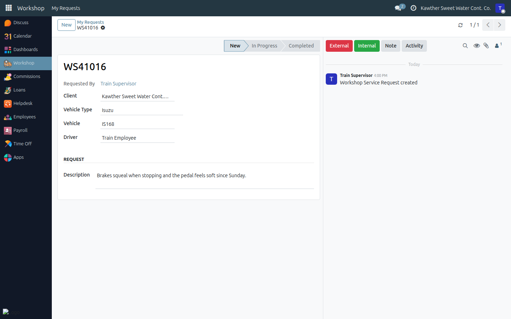
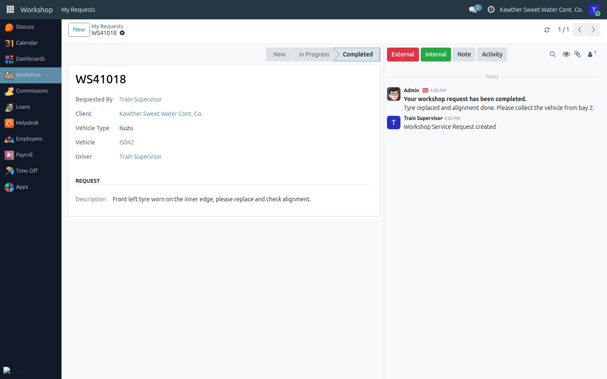
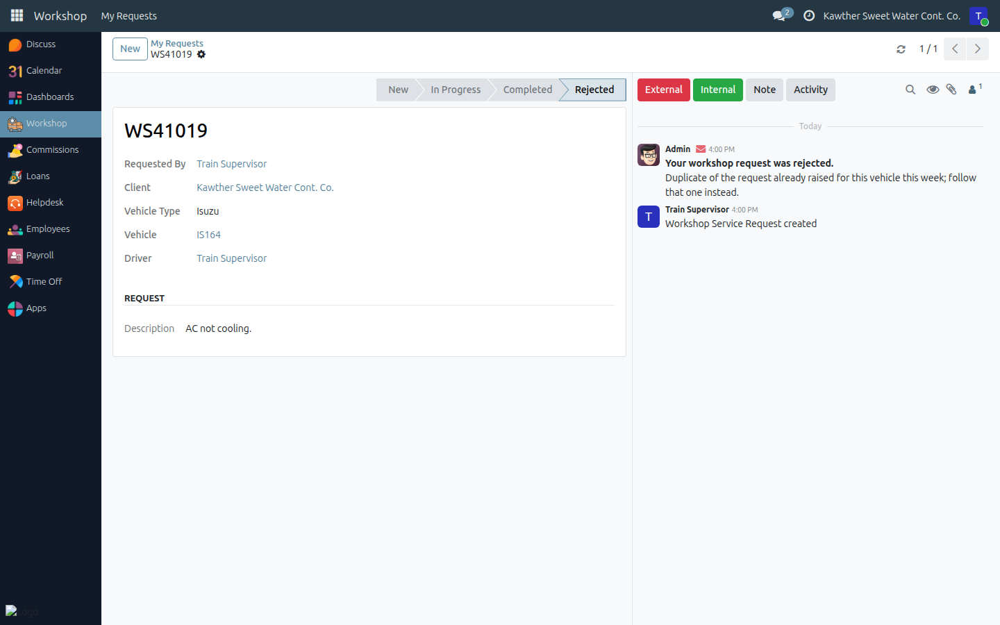
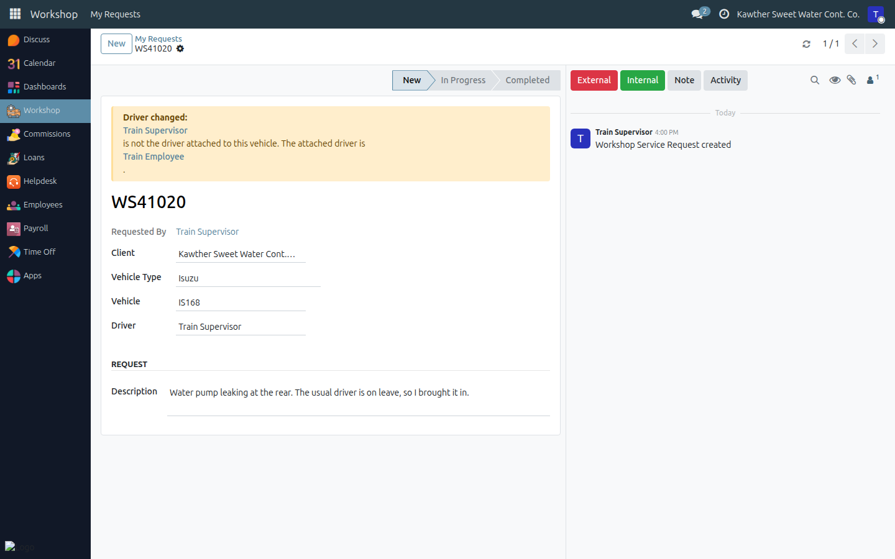

# Issuing a Workshop Service Request

**Who is this for:** Workshop Requesters: the Isuzu and trailer supervisors, and the maintenance department manager
**How long it takes:** 2 minutes

## What this does

Asks the workshop to inspect or repair one of your vehicles, as a tracked
request instead of a phone call or the old Google Form. The workshop manager
is notified the moment you submit. You can follow the request from the same
screen until the vehicle is done.

Each request gets a number (`WS00001`, `WS00002`, …) and moves through four
states:

| State | What it means |
|---|---|
| **New** | You have submitted it; the workshop has not started yet. You can still correct it. |
| **In Progress** | The workshop accepted it and is working on the vehicle. |
| **Completed** | The work is done. You get a message, often with collection details. |
| **Rejected** | The workshop will not do this request. You get a message explaining why. |

## Before you start

- **You need the Workshop Requester role.** Only the people who answer for
  vehicles raise requests. If you open **Workshop → My Requests** and there
  is no **New** button, you don't have the role. Ask your system
  administrator. (Drivers and other staff report a fault to their
  supervisor, who raises the request.)
- **You can only pick your own vehicles.** The vehicle list offers:
  - the trucks in **your tanker groups**, and
  - the trucks **driven by your team**: anyone in your reporting line, and you.

  The tanker groups are the same ones you use in **Water Delivery →
  Tankers**. If a truck you are responsible for is missing, it has to be added
  to your tanker group first.
- Know the vehicle's **fleet number** (e.g. `IS042`, `T171`) and be ready to
  describe the problem: what is wrong, since when, and any warning light or
  noise.

## Steps

1. **Open the Workshop app**, then **My Requests**. This list shows every
   request you have raised and its current state.
   

2. **Click New.** A blank request opens. **Requested By** is you and cannot be
   changed. **Client** is already set to the company, which is right for any
   company vehicle.
   

3. **Choose the Vehicle Type**: **Trailer**, **Isuzu**, **Tank** or **Other**.
   Choose it first, because the **Vehicle** list only shows vehicles of that
   type.

4. **Pick the Vehicle.** Click the field or start typing the fleet number.
   Only your own trucks of that type are listed: the ones in your tanker
   groups and the ones your team drives.
   

5. **Check the Driver.** When you pick the truck, **Driver** fills itself in
   with the driver attached to it. That is normally the person BAS shows
   driving it most over the last two weeks, or its default driver. If
   someone else is bringing the truck in, change it. This is allowed, but the
   request will then say so (see *What happens next*). Driver is required.

6. **Write the Description.** This is the most important field. The workshop
   reads it to plan the job, and the system uses it to sort the request by
   repair type (tyres, brakes, electrical…), so you do not choose a type
   yourself. Write plainly. For example, write *"Engine overheats on long
   trips; the temperature needle goes into the red after about an hour"*,
   not just *"engine problem"*.
   

7. **Click Submit Request** (top left). The request is saved, gets its `WS…`
   number and is sent to the workshop. A green *Request submitted* message
   confirms it. (Saving with the cloud icon does exactly the same thing.)
   

## What happens next

- **The workshop manager reviews it.** When they accept it, the state moves
  to **In Progress** and a technician starts on the vehicle. You can watch
  the state bar at the top of the request.
- **When the work is finished**, the request moves to **Completed**. You
  receive a message in your Inbox (the chat icon at the top right), on the
  request itself. It often includes a note from the workshop, such as where
  to collect the vehicle.
  
- **If the workshop will not do it**, the request moves to **Rejected**. The
  message tells you why. A common reason is that the same vehicle already
  has an open request.
  
- **If you changed the driver**, a yellow **Driver changed** box shows at the
  top of the request for everyone who opens it. It names the driver you
  entered and the driver attached to the truck, so the workshop knows who
  really brought it in. This is normal when the regular driver is on leave.
  Say why in the description.
  
- **To talk to the workshop about a request**, use the message box on the
  right of the request (the chatter). Click **External**, type and send.
  Attach a photo of the damage or warning light the same way. Everything
  stays on the request instead of in calls.

> **What you can and cannot change.** While the request is **New** you can
> correct anything except **Requested By**: open it, edit, save. Once the
> workshop has started, the request is locked for you. To add information,
> write in the chatter. The repair report (entry and exit times, odometer,
> parts, labour) is filled in by the workshop.

## Common issues

| Symptom | Cause | Fix |
|---|---|---|
| There is no **New** button on My Requests | You don't have the Workshop Requester role | Ask your system administrator. Until then, ask a supervisor who has it |
| The **Vehicle** list is empty | **Vehicle Type** is not set, or none of your trucks is of that type | Choose the right type first; the list follows it |
| A truck I am responsible for is not in the list | It is not in your tanker groups, and nobody on your team is its driver | Ask for it to be added to your tanker group (Water Delivery → Tankers) |
| "… is not one of your vehicles: it is not in your tanker groups and none of your team drives it" | The truck was picked some other way but is not yours | Pick one of your own trucks, or have it added to your tanker group |
| **Driver** filled in with the wrong person | BAS shows that person driving the truck most recently | Change it to whoever is bringing the truck. The request will show *Driver changed*, which is expected |
| "Vehicle Type and Driver are required…" when saving | **Driver** is empty (the truck has no driver attached) | Pick the driver yourself |
| I can't edit my request any more | It is no longer **New**: the workshop has started, finished or rejected it | Write in the request's chatter instead |
| There is no Delete option | Requests are never deleted, so the history stays complete | If you raised it by mistake, ask the workshop in the chatter to reject it |

## Related guides

- [Getting Started](../00-getting-started.md): login, navigation, notifications
