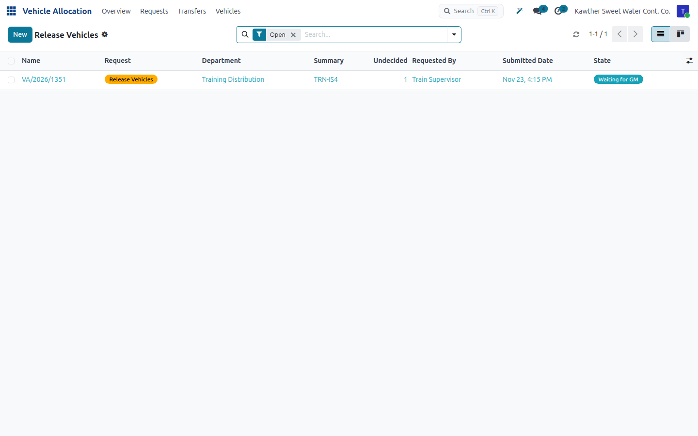
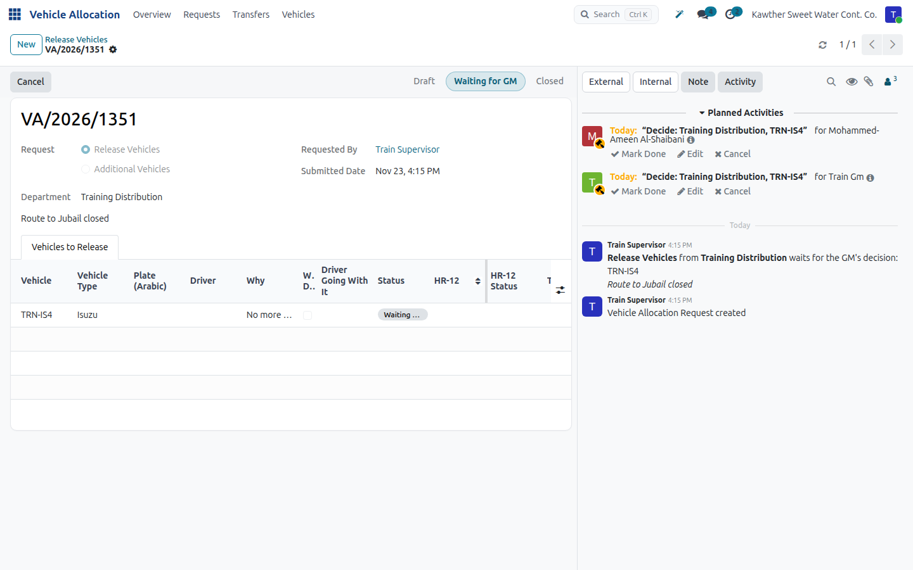
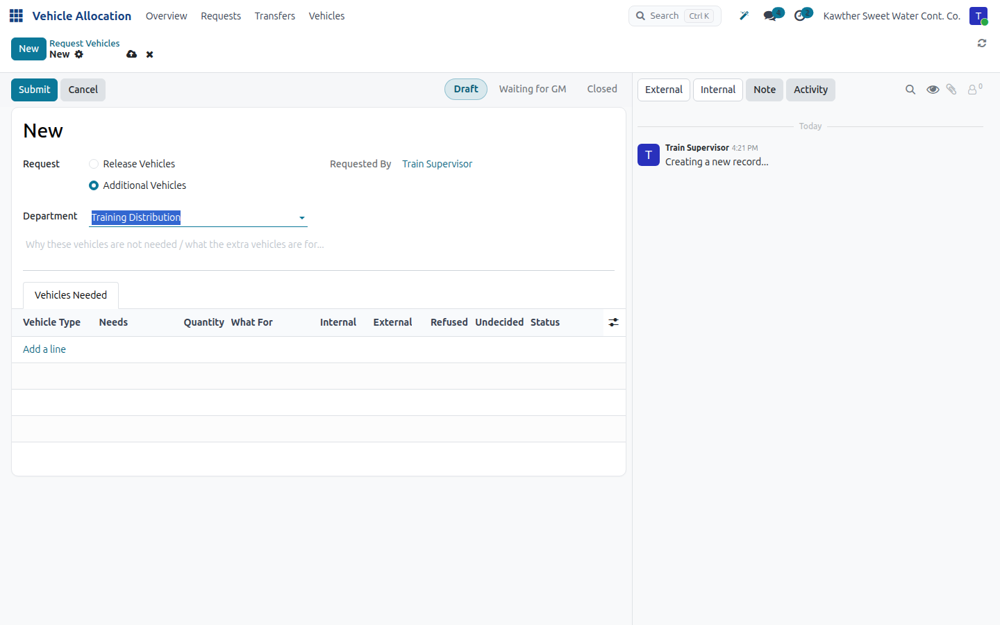

# Releasing and Requesting Vehicles

**Who is this for:** Department supervisors who answer for vehicles (Vehicle Allocation, *Department User*)
**How long it takes:** 3 minutes per request

## What this does

Every company vehicle belongs to a department. When your department no
longer needs a vehicle you **release** it; when it needs more you **request**
them. Both are only *asks*: the **General Manager** decides each vehicle. You
never move a vehicle yourself, and no vehicle leaves another department
unless that department released it.

| Request | You say | The GM can |
|---|---|---|
| **Release Vehicles** | which vehicles you give up, why, and whether the driver goes with it | give it to a department that asked, send it to the workshop to hold, or keep it with you |
| **Request Vehicles** | how many of which type, and whether you need the driver too | give released or pooled vehicles, obtain them outside (buy/rent), or refuse |

## Before you start

- You need **Vehicle Allocation → Department User** for your department(s).
  If the **Vehicle Allocation** app is missing, ask your system administrator.
- You only see and release **your own department's** vehicles.

## Releasing vehicles

1. **Open Vehicle Allocation → Requests → Release Vehicles.** The list shows
   your releases and their state.
   

2. **Click New.** **Department** is filled in (pick it if you answer for
   more than one). Write the **reason** in the box under it.

3. **Add each vehicle** under **Vehicles to Release**: the **Vehicle**, and in
   **Why** a short reason for that one. Tick **With Driver** only when the
   driver moves with the vehicle to the department that gets it (he keeps it
   in his custody and is transferred with it).

4. **Click Submit.** The request moves to **Waiting for GM** and the GM gets
   it on his Home page.
   

## Requesting vehicles

1. **Open Vehicle Allocation → Requests → Request Vehicles** and click **New**.
   

2. **Add a line per vehicle type** under **Vehicles Needed**: the
   **Vehicle Type**, **Needs**, **Quantity** and **What For**:

   | Needs | Choose it when |
   |---|---|
   | **Vehicle Only** | you have a driver for it |
   | **Vehicle with Driver** | you need the driver too |
   | **Either** | both are fine |

3. **Click Submit.**

## What happens next

- **The GM decides each vehicle.** The request stays **Waiting for GM** until
  every line is decided, then it is **Closed**. Each line shows its own
  **Status** (Transfer, To Workshop / Holding, Kept by Department…).
- **A vehicle that leaves you** goes to the workshop with a **Hand In
  (Release)** handover form (HR-12): the workshop inspects it and HR checks
  its papers. Its custodian is cleared when both are done.
- **A vehicle that comes to you** arrives with a **Receive** form. On your
  Home page you get *Name the new driver*: open the form, choose the **New
  User**, and click **Submit to HR**. HR checks his licence, then the workshop
  hands the vehicle over, which is its arrival in your department. The checks
  in [Changing a vehicle's driver](12-driver-change.md) apply to that driver too.
- **With Driver**: no workshop and no form; the vehicle and its driver move
  together the day the GM decides, and the driver's transfer is applied.

## Common issues

| Symptom | Cause | Fix |
|---|---|---|
| A vehicle is not in the list when releasing | It is not your department's, or it is already on another release or being moved | Check **Vehicle Allocation → Vehicles**; a vehicle on its way finishes moving first |
| I cannot edit my request | It has been submitted | Write in the chatter; the GM can return it to draft |
| "Waiting for GM" for days | The GM has not decided yet | It is on his Home page; ask him |

## Related guides

- [Changing a vehicle's driver](12-driver-change.md)
- [Releasing and requesting employees](13-release-and-request-employees.md)
- [Missing documents: asking HR](14-document-requests.md)
