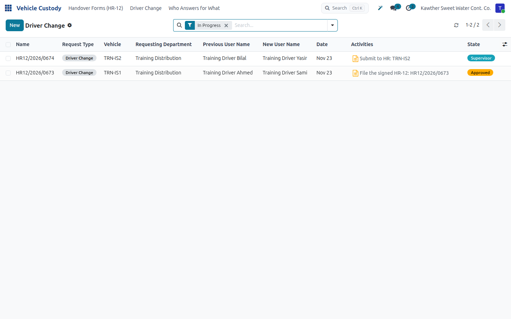
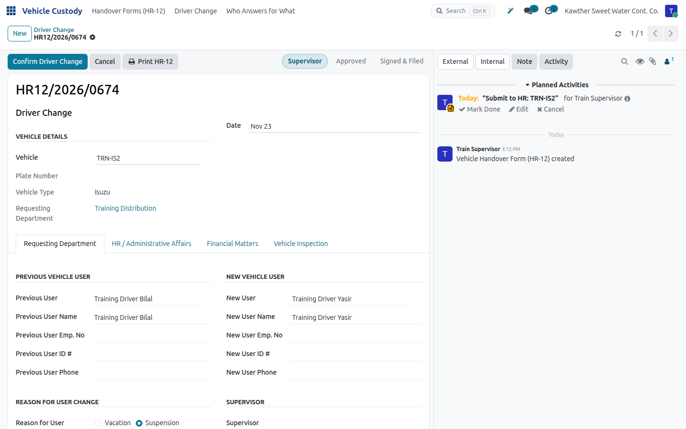
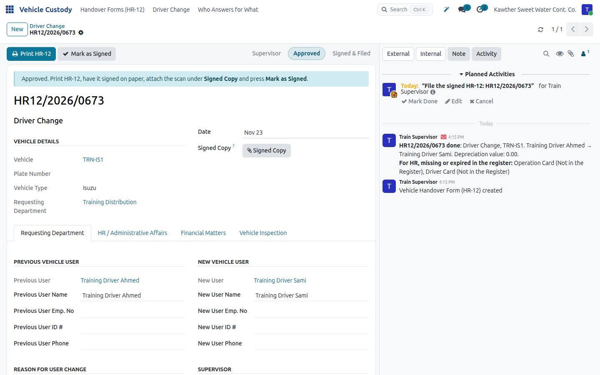
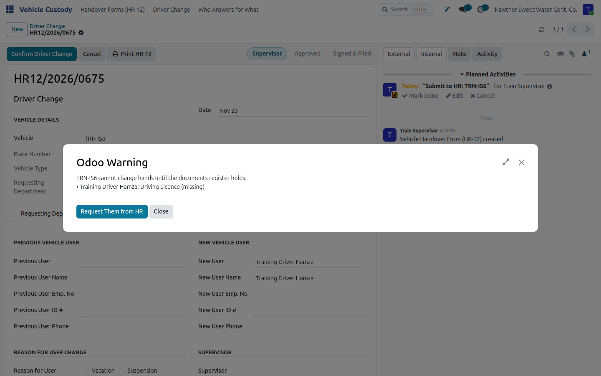
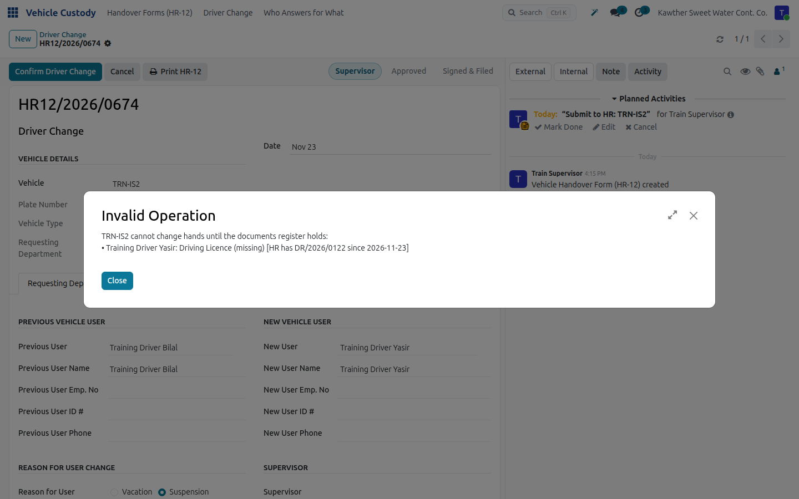

# Changing a Vehicle's Driver (HR-12)

**Who is this for:** Department supervisors (Vehicle Allocation, *Department User*)
**How long it takes:** 2 minutes

## What this does

Hands one of your vehicles from its current driver to another driver **of
your own department**: vacation, suspension, a new route. It is your
department's own decision: there is no GM step, no workshop checkup and no HR
step. When every check passes, **Confirm Driver Change** gives the vehicle to
the new driver at once, and HR and Accounting are told.

## Before you start

The system checks these before the vehicle changes hands, and the **New
User** list only offers drivers who pass the first four:

| Check | Why |
|---|---|
| **One driver, one vehicle**: he does not already answer for a driven vehicle | a driver drives one truck at a time (a tedder does not count: it goes with its head) |
| He is not already the new driver on another handover or plan | no one is promised two vehicles |
| He is not being released himself | he is leaving |
| He is in **your department** | a driver change stays inside the department |
| The **documents register** holds his valid **driving licence**, of a class that fits the vehicle (heavy transport for a trailer), and the vehicle's papers (istimara, insurance, periodic inspection, operation card, tank licence) | the vehicle cannot legally change hands without them |

## Steps

1. **Open Vehicle Custody → Driver Change** and click **New**.
   

2. **Choose the Vehicle.** **Previous User** fills itself in with its
   current custodian.

3. **Choose the New User** from the list, pick the **Reason for User Change**
   and add a note if needed.
   

4. **Click Confirm Driver Change**, then confirm. If everything is in order
   the form moves to **Approved** and the vehicle is now in the new driver's
   custody.
   

5. **Print HR-12**, have it signed, scan it, attach the scan under **Signed
   Copy** and click **Mark as Signed**. Your Home page reminds you until you do.

## When the documents are missing

If the register lacks a document, the form is refused with the list of what
is missing, and a **Request Them from HR** button:

Click **Request Them from HR**: one request per missing document goes to HR,
and you follow them in **My Document Requests** (see
[Missing documents: asking HR](14-document-requests.md)). When HR registers
them you are told; confirm the driver change again.

If you already asked, the message says so instead, naming the request:

A licence of the **wrong class** (a private licence for a trailer) is refused
without the button: HR cannot fix that by registering it. Choose another driver.

## What happens next

- HR gets a message that the change is done, with anything the register is
  missing for the vehicle, for information.
- Accounting gets a copy (financial matters, depreciation value).
- The custody history (**Vehicle Custody → Who Answers for What**) shows the
  new driver from today.

## Common issues

| Symptom | Cause | Fix |
|---|---|---|
| A driver is not in the **New User** list | He already holds a vehicle, is promised one, is being released, or is not in your department | Hand his vehicle over first, or choose another driver |
| "… already answers for …, as many vehicles as he may hold" | He holds a vehicle | Same as above. HR can allow a second vehicle for a recorded reason |
| "… already has HR12/… open" | The vehicle has another open form | Finish or **Cancel** that one first |
| I started one by mistake | It is still a draft | **Cancel** (top left) |

## Related guides

- [Releasing and requesting vehicles](11-release-and-request-vehicles.md)
- [Missing documents: asking HR](14-document-requests.md)
