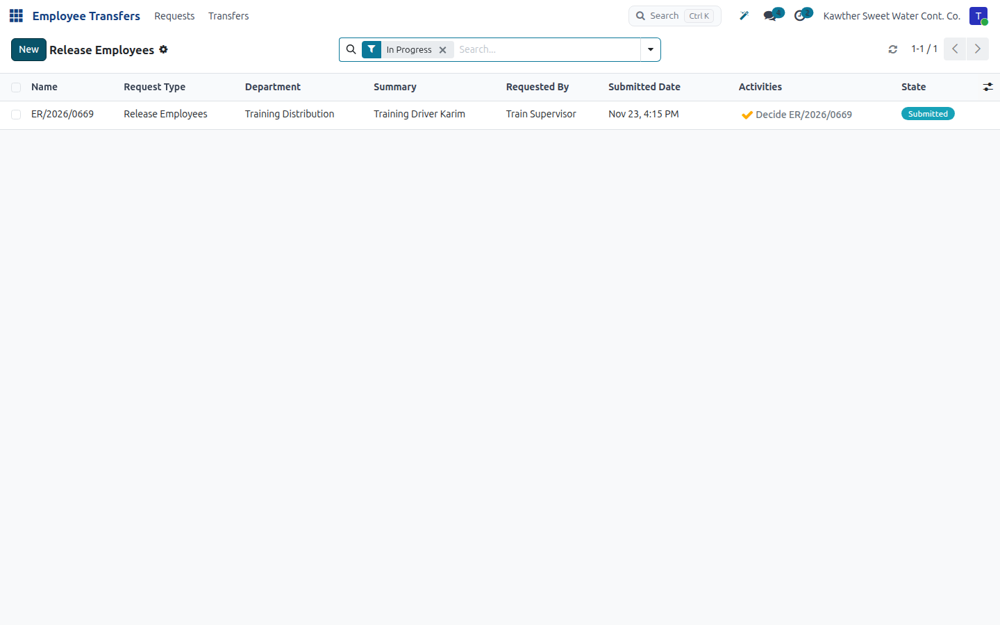
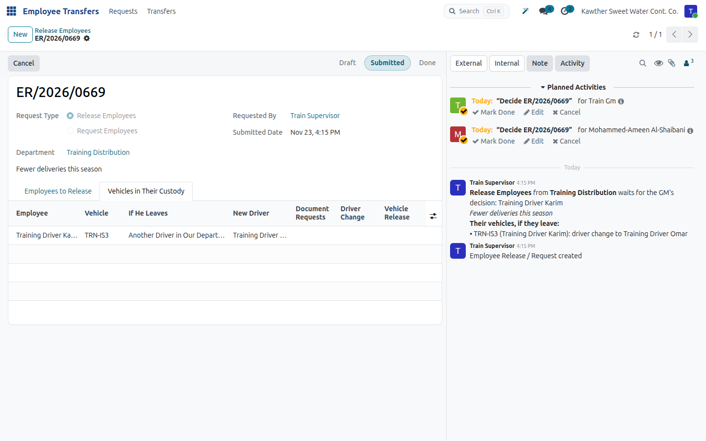
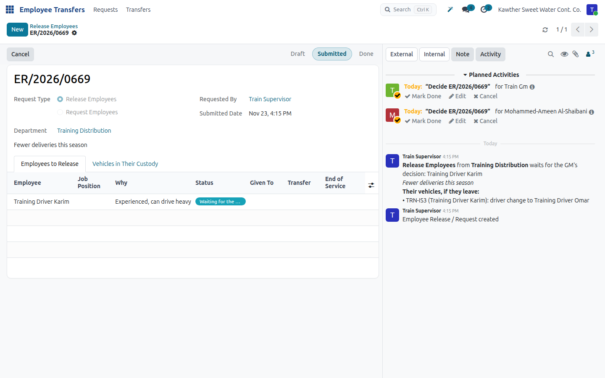

# Releasing and Requesting Employees

**Who is this for:** Department managers (Employee Transfers, *Requester*)
**How long it takes:** 3 minutes per request

## What this does

Works like vehicles: your department **releases** employees it no longer
needs, or **requests** employees it needs (job and number). Only the
**General Manager** decides: he transfers a released employee to a
department that asked, holds him, ends his service, or refuses the release.
HR then carries out the decision.

## Before you start

- You need **Employee Transfers → Requester**. You act for the departments
  you manage (and their sub-departments).
- If an employee you release **answers for vehicles**, you also say what
  happens to each vehicle if he leaves.

## Releasing employees

1. **Open Employee Transfers → Requests → Release Employees** and click **New**.
   

2. **Write the reason**, and under **Employees to Release** add each
   employee with **Why** (what the GM should know about him).

3. **Save.** If an employee answers for vehicles, a **Vehicles in Their
   Custody** tab appears with one line per vehicle. For each, choose **If He
   Leaves**:

   | If He Leaves | What happens when he leaves |
   |---|---|
   | **Another Driver in Our Department** | choose the **New Driver**; the vehicle stays with you (a driver change) |
   | **Release to the Workshop** | a vehicle release goes to the GM |

   The **New Driver** list follows the rules in
   [Changing a vehicle's driver](12-driver-change.md): one vehicle per driver,
   not someone who is leaving, valid licence. A missing document stops the
   submit with **Request Them from HR**.
   

4. **Click Submit to the GM.** The request is **Submitted** and the GM sees
   the vehicle plan with it.
   

> **Nothing happens to the vehicles before he actually leaves.** If the GM
> keeps him, the plan is dropped; if he transfers or his service ends, the
> plan runs that day.

## Requesting employees

1. **Open Employee Transfers → Requests → Request Employees** and click **New**.
2. **Add a line per job**: the **Job Position**, how many, and a note.
3. **Click Submit to the GM.**

## What happens next

- The GM decides each employee. A transfer goes to HR, who sets his new
  manager and approvers and applies it on the effective date. If he still
  answers for a vehicle, the transfer waits until the vehicle is handed over.
- For a request, the GM may give you released employees, or have HR hire
  from outside.

## Common issues

| Symptom | Cause | Fix |
|---|---|---|
| "… answers for TRN-…: say in Vehicles in Their Custody what happens to it" | A vehicle has no plan | Open the tab and choose **If He Leaves** |
| An employee is not in the list | He is not in a department you manage, or is already released | Ask HR to check his department |
| The New Driver I want is not offered | He holds a vehicle, is leaving, or is promised one | See [Changing a vehicle's driver](12-driver-change.md) |

## Related guides

- [Releasing and requesting vehicles](11-release-and-request-vehicles.md)
- [Missing documents: asking HR](14-document-requests.md)
