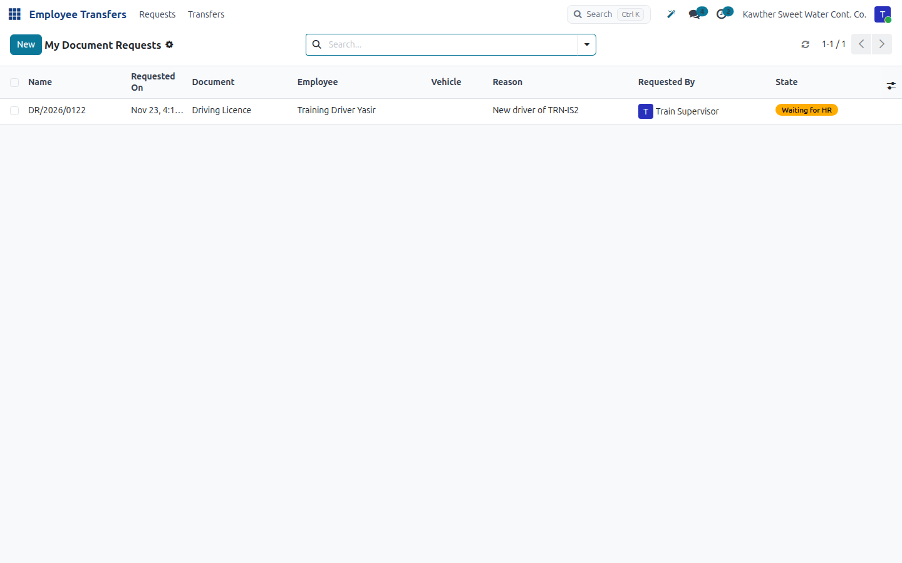
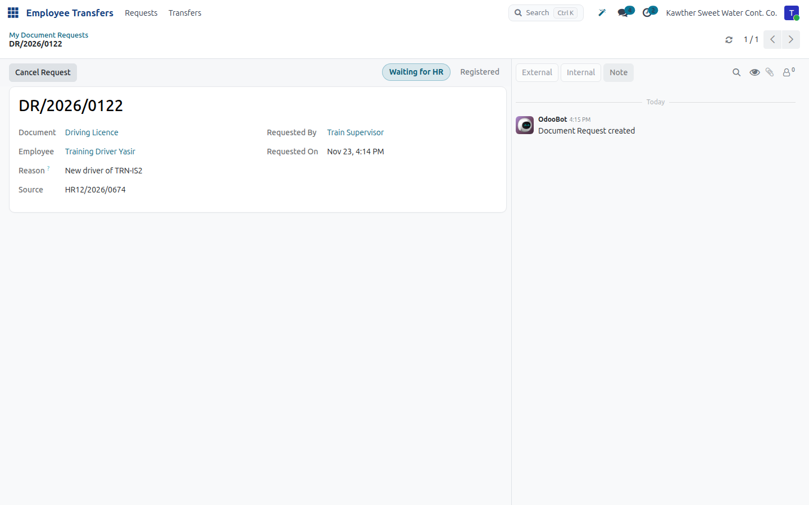

# Missing Documents: Asking HR

**Who is this for:** Department supervisors
**How long it takes:** 1 minute

## What this does

A vehicle cannot change hands while the **documents register** lacks one of
its papers or the new driver's licence. HR keeps the register; you do not
see it. Instead, the message that stops you carries a **Request Them from
HR** button, and each missing document becomes a **Document Request**
(`DR/2026/…`) that is yours to follow.

## Steps

1. **Click Request Them from HR** on the message (see
   [Changing a vehicle's driver](12-driver-change.md)). A green note confirms
   the request numbers.

2. **Follow them** in **Employee Transfers → Requests → My Document
   Requests**, or on the release's **Vehicles in Their Custody** tab
   (**Document Requests** column).
   

3. **Open one** to see what was asked, why, and its state.
   

| State | Means |
|---|---|
| **Waiting for HR** | HR has it on their Home page |
| **Registered** | HR has registered the document; you got a message. Submit or confirm again |
| **Cancelled** | You or HR cancelled it |

## Reading the papers yourself

**Vehicle Custody → Documents** lists, read only, the papers of your
departments' vehicles **and employees**: licences, iqamas, istimara,
insurance, with their expiry. You cannot change them; HR does.

## What happens next

The request closes itself the moment a valid document is in the register,
whether HR typed it from your request or it came in with a government export.
You do not need to chase it: you are told.

## Common issues

| Symptom | Cause | Fix |
|---|---|---|
| "[HR has DR/… since …]" in the message | You (or another supervisor) already asked | Wait for the message that it is registered |
| I asked by mistake | It is still waiting | Open it and click **Cancel Request** |
