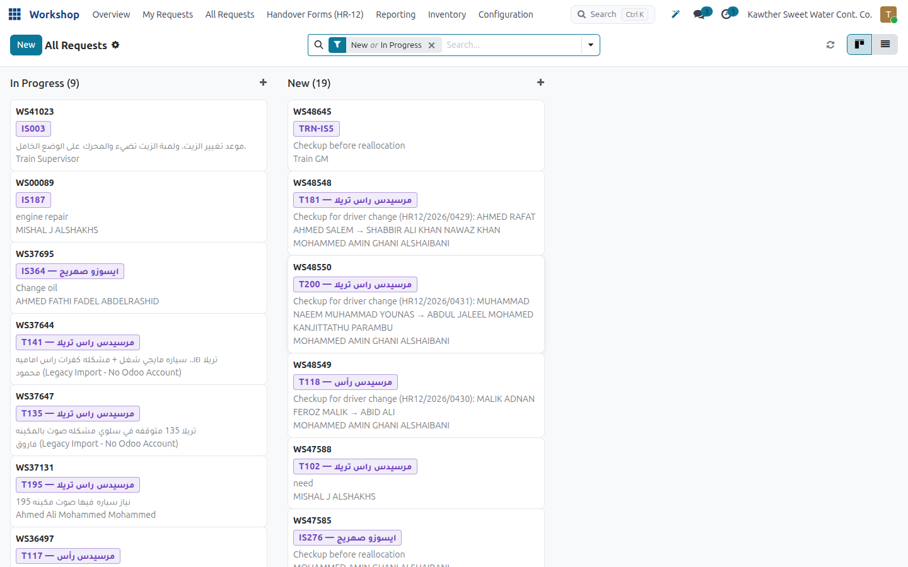
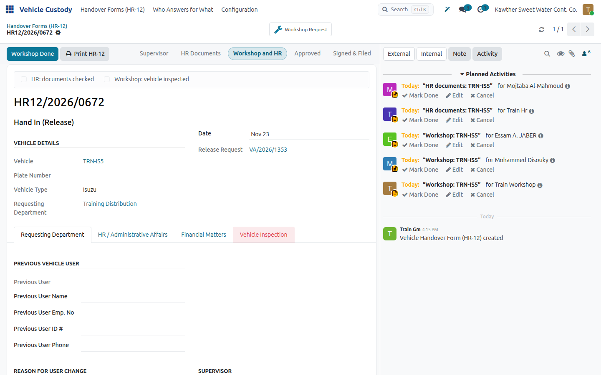
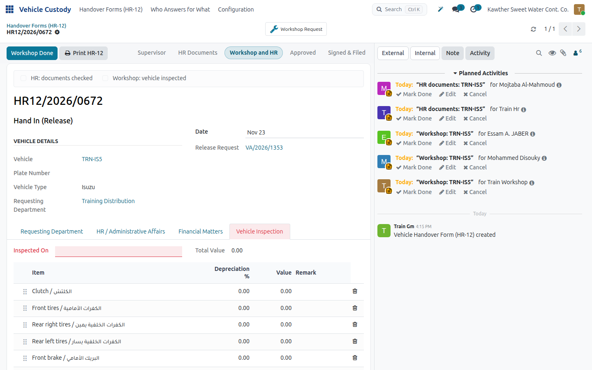

# The Workshop Manager's Queue, Sites and Handover Forms

**Who is this for:** Workshop Managers and Technicians
**How long it takes:** ongoing

## What this does

There are three workshops: **Nabiya** (the main one), **Tabuk** and
**Al-Hayat**. Every request goes to one of them, and you work the queue of
**your own** workshop(s). Besides repair requests, the workshop has a step
on the vehicle **handover forms (HR-12)**: inspecting a vehicle that is handed
in, and handing a vehicle over to its new department.

## Before you start

- You are in your workshop's **Managers & Staff** (**Workshop →
  Configuration → Workshops**). In none, you see nothing: ask your
  administrator.
- The GM and the reviewers see every workshop; on the dashboard they switch
  between them.

## Where a request goes

A request goes to the workshop that **serves the requester's department**
(or its nearest parent department), otherwise to Nabiya. Requests raised
before the three workshops existed are Nabiya's.

1. **Open Workshop → All Requests.** The **Workshop** column shows the site;
   you only see yours.
   

2. Work the requests as before: accept (In Progress), fill the repair report,
   **Complete** or **Reject**. See the requester's guide,
   [Issuing a workshop service request](../supervisor/10-workshop-request.md),
   for what they see.

## Handover forms (HR-12)

Open them from your Home page (*Workshop: TRN-…*) or **Vehicle Custody →
Handover Forms (HR-12)**.

| Form | Your part |
|---|---|
| **Hand In (Release)** | inspect the vehicle that is handed in, **in parallel** with HR's documents check. A checkup **Workshop Request** is opened with it (button at the top) |
| **Receive** | after HR has checked the new driver, hand the vehicle over to him: **that is its arrival** in the new department |

1. **Open the Vehicle Inspection tab.** Fill **Inspected On** and, per item
   (clutch, tyres, brakes…), the **Depreciation %**, **Value** and a remark.
   The **Total Value** is what Accounting receives.
   

2. **Click Workshop Done.** On a hand-in the form is **Approved** when HR has
   also checked the documents; on a receipt it is the arrival: the vehicle is
   the department's and the driver's from now on.

> A driver change between two drivers of the same department has **no
> workshop step** any more.

## Common issues

| Symptom | Cause | Fix |
|---|---|---|
| The queue is empty | Your user has no workshop | Ask the administrator to add you to your workshop |
| A request went to the wrong workshop | The requester's department is served by another workshop, or by none (then Nabiya) | The administrator sets **Departments Served** under **Workshop → Configuration → Workshops** |
| No **Workshop Done** button on a Receive | HR has not checked the driver yet | It comes after **Documents Checked** |
